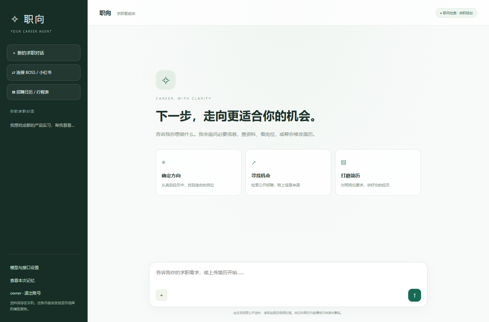
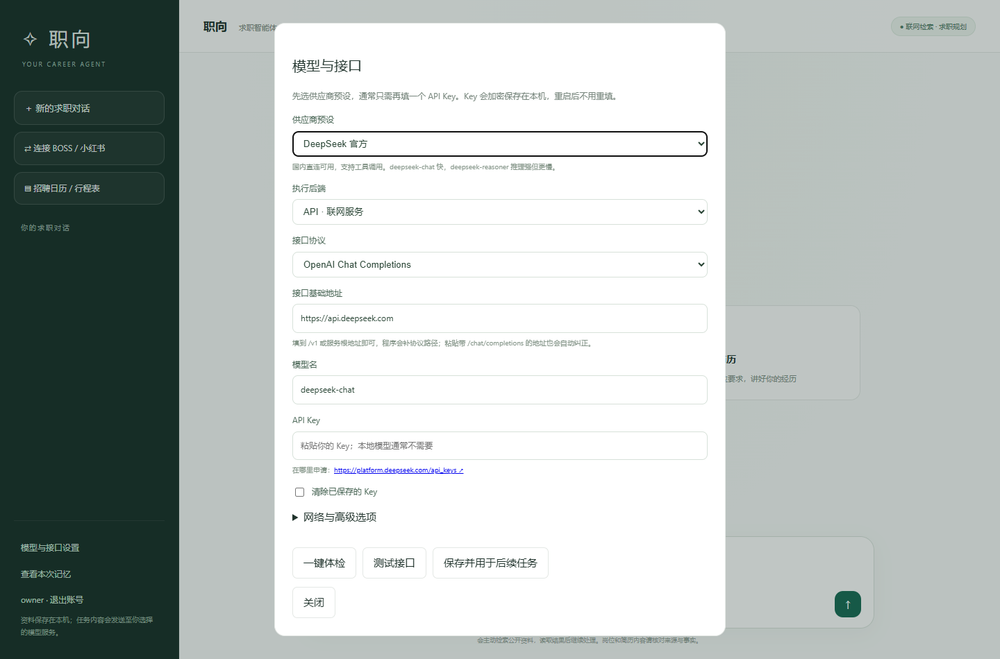
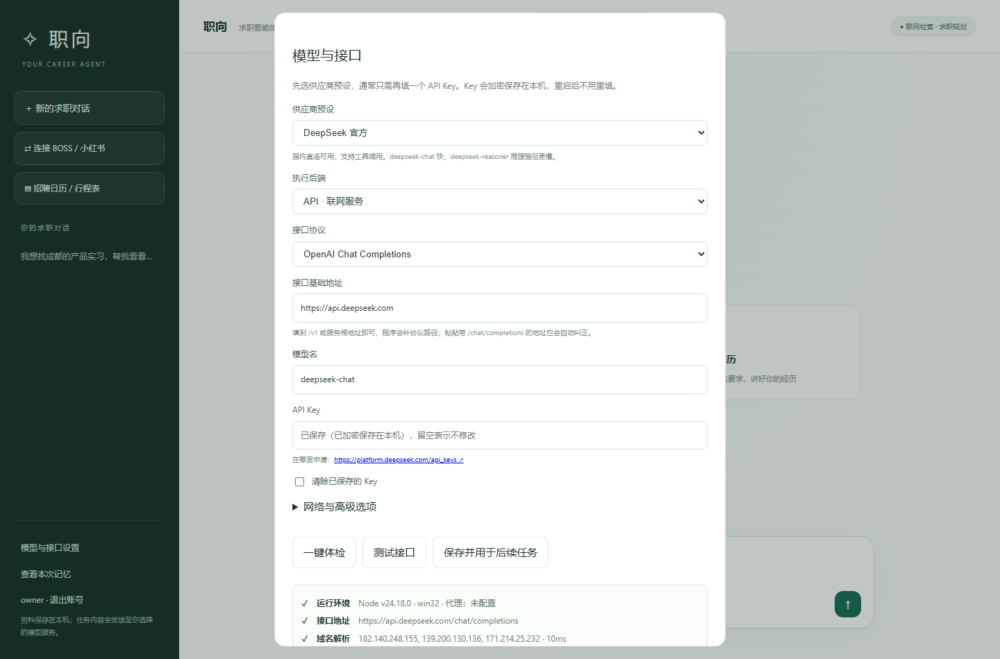
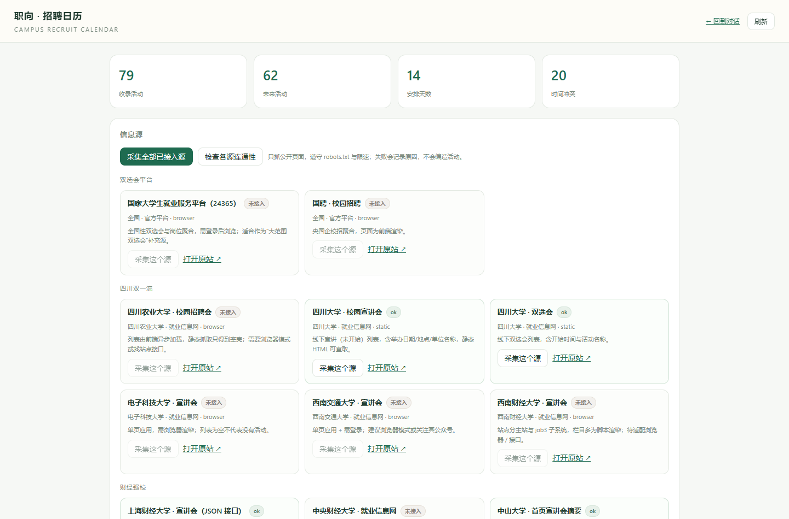

# 04 · 操作手册（零基础上手）

> 目标：**不写一行代码**，把项目跑起来、配好模型、采到真实招聘信息、导出自己的行程表。
> 全程约 10 分钟。

---

## 0. 准备（只需一次）

| 需要 | 版本 | 检查方法 |
| --- | --- | --- |
| Windows 10/11 | — | — |
| Node.js | **23 或更新**（内置 SQLite） | 命令行输入 `node -v` |
| Microsoft Edge | 任意较新版本 | 系统自带即可（平台登录、浏览器模式用） |
| 网络 | 能访问高校就业网 | 打开 `https://jy.scu.edu.cn` 试试 |

> 如果 `node -v` 显示 22.x，请到 <https://nodejs.org/> 下载 LTS 最新版覆盖安装。
> 本项目用到了 Node 内置的 `node:sqlite`，22.x 需要额外参数，不推荐。

---

## 1. 启动

双击 **`开始使用.cmd`**。

- 第一次会自动安装依赖（`npm ci`），需要 1–3 分钟，请保持网络。
- 启动成功会自动打开浏览器：<http://127.0.0.1:4189>
- 如果没自动打开，手动在浏览器输入这个地址。

> 想让手机也能看？双击 **`开始使用-局域网.cmd`**，控制台会打印一个 `http://192.168.x.x:4189` 的地址，手机连同一个 Wi-Fi 打开即可。

---

## 2. 登录

第一次打开会看到登录框：

1. 账号：`owner`
2. 密码：打开文件夹里的 **`.data\首次登录.txt`**，里面有密码。
3. 点「登录」。

> 也可以点「创建测试账号」注册自己的账号（密码至少 10 位）。每个账号的数据完全隔离。



---

## 3. 配置模型（最关键的一步）

点左下角 **「模型与接口设置」**。



### 路线 A：智谱 GLM（有免费额度，零成本，推荐先试）

1. 打开 <https://bigmodel.cn/console> 注册，创建 API Key。
2. 「供应商预设」选 **智谱 GLM（有免费档）**。
3. 地址、协议、模型名会自动填好（`glm-4-flash`）。
4. 把 Key 粘贴到「API Key」。
5. 点 **「一键体检」**。
6. 全部 ✔ 后，点 **「保存并用于后续任务」**。

### 路线 B：DeepSeek（便宜、快、支持工具调用）

1. 打开 <https://platform.deepseek.com/api_keys> 创建 Key。
2. 预设选 **DeepSeek 官方**，模型 `deepseek-chat`。
3. 粘贴 Key → 一键体检 → 保存。

### 路线 C：完全离线（Ollama）

1. 安装 <https://ollama.com/download>，命令行执行 `ollama pull qwen2.5:7b`。
2. 预设选 **本机 Ollama**，地址 `http://127.0.0.1:11434/v1`。
3. 体检 → 保存。
4. 注意：小模型的工具调用不稳定，适合演示"能跑"，不适合复杂简历改写。

### Key 会被保存吗？

会。Key 用 AES-256-GCM 加密后存在 `.data\users\<你的账号>\.data\secrets.enc.json`，**重启不用重填**。
页面上永远显示为密码框，保存后不会再回显。

---

## 4. 一键体检怎么看

点「一键体检」，会依次检查 7 步：

| 显示 | 含义 | 怎么办 |
| --- | --- | --- |
| ✔ 运行环境 | Node 版本、是否配置代理 | — |
| ✔ 接口地址 | 地址是否合法、是否自动纠正 | 地址错 → 按预设重选 |
| ✔ 域名解析 | 能不能找到服务器 | ✘ → 拼写、DNS、代理 |
| ✔ 端口连通 | 443/端口通不通 | ✘ → 服务没起/防火墙 |
| ✔ HTTPS 证书 | 证书是否受信任 | ✘ → 换证书或用本机 HTTP |
| ✘ 接口与鉴权 | Key、权限、模型名 | 401→换 Key；404→改协议/模型名 |
| ! 工具调用 | 模型支不支持 function calling | 换 DeepSeek/GLM/Qwen |
| ! 结构化输出 | 能不能稳定返回 JSON | 换更强模型 |



**✔ 全绿 = 可以开始对话。** 有 `!` 也能用，只是检索类功能会弱一些。

---

## 5. 招聘日历：采集真实线下招聘

点左侧 **「▤ 招聘日历 / 行程表」**，或直接访问 <http://127.0.0.1:4189/recruit>。



### 5.1 采集

1. 点 **「采集全部已接入源」**（约 10–30 秒）。
2. 看下方「运行记录」：每个源会显示 `ok` / `blocked` / `error` 及原因。
3. 绿色标签 = 采集成功；灰色 = 未接入；红色 = 被拦截或失败（不是"没有活动"）。

### 5.2 看行程

- 默认显示未来 30 天。
- 红色左边框 = 时间冲突；橙色 = 赶场紧张或地点未公布。
- 每张卡片有：时间、活动、单位、地点、通勤估算、置信度、来源链接。

### 5.3 复核

点卡片上的 **「复核来源」**：系统会重新打开原始页面，确认标题还在。
- 还在 → 标记"已复核"；
- 页面变了 → 提示"请人工确认"。

### 5.4 导出

| 按钮 | 用途 |
| --- | --- |
| 导出日历 `.ics` | 导入手机日历 / Outlook / Google Calendar，到点提醒 |
| 导出表格 `.csv` | 用 Excel 打开、排序、打印 |
| 导出安排表 `.md` | 交作业、贴到文档里 |

**导入手机日历**：把 `.ics` 发到手机 → 用系统"日历"打开 → 添加全部。iOS / Android / 华为 / 小米都支持。

---

## 6. 和智能体对话可以这样问

配置好模型后，回到首页，直接说：

- 「把未来两周成都的宣讲会按天排一下，标出会冲突的场次」
- 「上海财经大学 10 月 26 日那几场，哪些公司是金融行业？帮我按行业归类」
- 「我想投银行，帮我把简历往‘数据分析 + 客户沟通’方向改，不要编造经历」
- 「这家公司（贴公司名）怎么样？帮我查公开信息，说明信息来源」
- 「根据这个岗位 JD 和我上传的简历，列出我还缺什么证据」

智能体会：
1. 先制定 1–5 步计划给你看；
2. 调用工具（读取本机招聘库 / 公开搜索 / 平台页面）；
3. 输出回答 + 来源 + 可下载的简历文稿；
4. 最后做一次事实复核。

> 上传简历：点输入框左边「附件」，支持 `.docx` / `.pdf` / `.txt`（单文件 ≤8MB）。

---

## 7. 手机 / 平板 / 另一台电脑

### 同一 Wi-Fi

双击 `开始使用-局域网.cmd` → 手机浏览器打开控制台打印的 `http://192.168.x.x:4189`。

### 不同网络

用 Tailscale（免费）：电脑和手机装好并登录同一账号 → 电脑执行 `tailscale serve --bg 4189` → 手机访问生成的 `https://...ts.net` 地址。
详见 [03 · 多设备部署](03-接口连接与多设备.md)。

---

## 8. 命令行（可选）

```bash
# 查看信息源状态
node recruit/cli.mjs sources

# 采集（默认写入当前账号的数据目录）
node recruit/cli.mjs collect --limit 20

# 只采某一个源
node recruit/cli.mjs collect --source scu-employ --limit 15

# 打印时间表
node recruit/cli.mjs list --days 30

# 导出
node recruit/cli.mjs export --format ics --days 30 --out schedule.ics

# 复核来源是否还有效
node recruit/cli.mjs verify

# 检查各源连通性
node recruit/cli.mjs probe

# 接口体检
node diag-cli.mjs
```

---

## 9. 备份、迁移、分享

| 想做什么 | 做法 |
| --- | --- |
| 备份自己的数据 | 复制 `.data\users\<你的账号ID>` |
| 换电脑 | 整个文件夹拷过去，`npm ci` 后双击启动 |
| 分享给同学 | **只发代码文件，不要发 `.data`**（含简历、账号、Key、登录态） |
| 重置全部 | 删除 `.data` 后重启（会重新生成 owner 账号） |

---

## 10. 常见报错对照

| 页面提示 | 原因 | 解决 |
| --- | --- | --- |
| `未找到 Codex 安装` | 后端选了"本机 Codex" | 改成 API 或本地模型 |
| `鉴权失败（HTTP 401）` | Key 错/过期 | 重新填 Key，或换预设 |
| `接口或模型不存在（HTTP 404）` | 协议或模型名错 | chat/messages 切换，核对模型名 |
| `连接超时` | 网络不通/需要代理 | 填代理，或换国内供应商 |
| `模型未返回有效的结构化结果` | 输出被截断或模型不返回 JSON | 提高输出上限、换模型、把任务拆小 |
| `请先登录自己的测试账号` | 未登录 | 看 `.data\首次登录.txt` |
| `Host rejected` | 用了域名/局域网访问但没加白名单 | 设置 `CAREER_ALLOWED_HOSTS` |
| 采集显示 `blocked` | 站点反爬 | 换浏览器模式，或关注公众号人工转发 |
| 采集显示 `empty` | 页面能开但解析不到 | 站点改版，需要更新选择器 |

---

## 11. 关闭程序

- 关闭浏览器页面不会停止服务。
- 要彻底停止：在任务管理器里结束本项目的 `node.exe`（注意不要误关其它 Node 程序），或在该窗口按 `Ctrl+C`。
- 日志在 `.data\server.log` 与 `.data\server-error.log`。

---

下一篇：[05 · 答辩要点](05-答辩要点.md)
