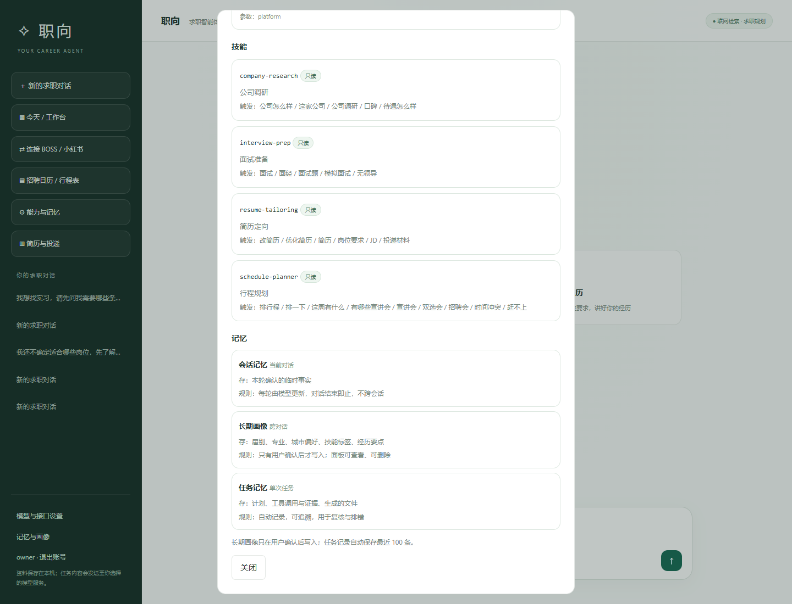
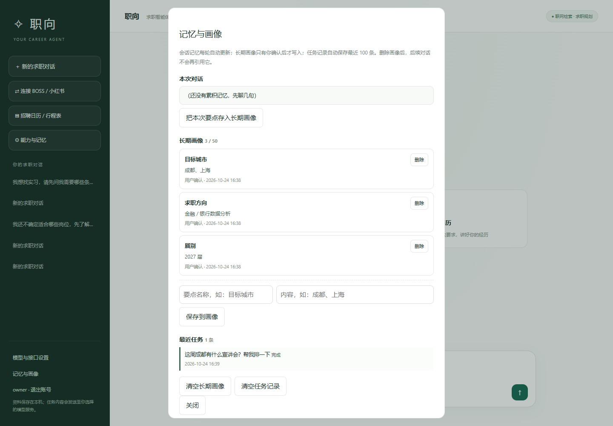

# 08 · 工具与能力清单（M6 已落地）

> 回答"我到底用了哪些 tool、有哪些 skill、记忆是什么"。
> 现在这些不再是代码里的隐式约定，而是**注册表 + 能力面板**。

---

## 1. 当前 12 个工具

| 工具名 | 权限 | 超时 | 做什么 | 依赖 |
| --- | --- | --- | --- | --- |
| `resume_list` | 只读 | 5s | 列出本机简历与版本数 | 简历库 |
| `resume_read` | 只读 | 5s | 读取简历最新版正文与 JD | 简历库 |
| `interview_list` | 只读 | 5s | 列出面试准备、题目数、已答数 | 面试库 |
| `interview_read` | 只读 | 5s | 读取准备内容与题库 | 面试库 |
| `company_list` | 只读 | 5s | 列出公司档案 | 公司档案库 |
| `company_read` | 只读 | 5s | 按 id/名称读取公司档案 | 公司档案库 |
| `career_recruit_events` | 只读 | 8s | 查本机招聘库，按天/学校/类型排行程 | 已采集数据 |
| `career_company_research` | 只读 | 25s | 公司公开信息调研（行业/校招/口碑） | SearXNG 搜索地址 |
| `career_public_search` | 只读 | 20s | 公开网络搜索摘要 | SearXNG 搜索地址 |
| `career_platform_status` | 只读 | 8s | 检查 7 个登录型网站（BOSS/小红书/实习僧/牛客/智联/51job/猎聘）连接状态 | 本机平台浏览器 |
| `career_platform_search` | 只读 | 120s | 在本人登录的平台浏览器里搜索 | 同上 |
| `career_platform_read` | 只读 | 60s | 读取当前岗位/笔记页面 | 同上 |

全部是**只读**。保存简历、记录投递由界面按钮完成（点击即确认），模型没有写权限，避免"自作主张写库"。

---

## 2. 一次工具调用发生什么

```
模型请求 career_recruit_events {days:7}
        │
        ▼
① registry.mjs   查定义：参数 schema、权限、超时
② policy.mjs     校验：未知字段/必填/范围/长度，去空格
③ execute.mjs    去重（同一任务同一参数只调一次）
                 权限检查（write 需要 confirm）
                 超时控制（AbortController）
④ handlers/…     真正执行（查库 / 搜索 / 平台桥接）
⑤ 返回结构化结果或 {status:'error', code, message, recovery}
```

任何一步失败都会变成模型看得懂的 `code + message + recovery`，而不是一句"工具失败"。

---

## 3. 在界面上看

左侧 **「⚙ 能力与记忆」**：



- 工具数量、只读/可写数量；
- 每个工具的名称、标题、说明、参数、超时；
- 技能列表（M7 补充）；
- 三层记忆的存放范围与写入规则。

命令行等价物：

```bash
npm run tools
```

---

## 4. 文件对应关系（不再三处重复）

| 以前 | 现在 |
| --- | --- |
| `api-model.mjs` 里的 `API_TOOLS` | `src/tools/registry.mjs` |
| `tool-policy.mjs` 里的字段白名单 | `src/tools/policy.mjs`（从 schema 推导） |
| `api-model.mjs` 里的工具实现 | `src/tools/handlers/*.mjs` |
| `platform-mcp.mjs` 里的 MCP 工具描述 | 从 registry 生成 |

新增一个工具只需要：

1. 在 `registry.mjs` 加一条定义（名称、说明、schema、权限、超时、handler id）；
2. 在 `handlers/` 写实现；
3. 在 `execute.mjs` 的 `HANDLERS` 注册一行；
4. 加一个测试。

**模型、能力面板、MCP、CLI 会同时看到它，不需要改四个地方。**

---

## 5. 技能（Skill）现状（M7 已落地）

文件夹契约 + 3 个技能（行程规划已按新需求移除）：

```
src/skills/<id>/
├─ SKILL.md      # 元信息 + 步骤 + 边界
├─ prompt.md     # 模型约束
└─ checklist.md  # 验收清单
```

| 技能 | 触发 | 可用工具 | 产出 |
| --- | --- | --- | --- |
| `company-research` | 公司怎么样 / 口碑 | 两个搜索工具 | 带来源的公司简报 |
| `resume-tailoring` | 改简历 / 岗位要求 / JD | 无 | 证据映射 + 定制简历 + 缺口 |
| `interview-prep` | 面试 / 面经 / 模拟面试 | 两个搜索工具 | 流程预测 + 题库 + 复盘 |

选中技能后，聊天状态显示「使用技能：xxx」，模型只能看到该技能允许的工具。详见 [09 技能清单](09-技能清单.md)。
---

## 6. 记忆现状（M8 已落地）



| 层 | 存什么 | 存哪 | 写入规则 |
| --- | --- | --- | --- |
| 会话记忆 | 当前对话确认的事实 | 会话 JSON | 每轮自动 |
| 长期画像 | 届别、专业、城市偏好、技能标签 | `memory/profile.json` | **用户确认后才写**，可删 |
| 任务记忆 | 计划、工具、产出、耗时 | `memory/tasks.json` | 自动，保留最近 100 条 |

- 画像会进入系统提示词（`buildPrompt` → `context.profile`），下一轮对话直接生效；
- 接口：`GET /api/memory?session=`、`POST /api/memory/profile|profile/import|profile/delete|profile/clear|tasks/clear`；
- 面板：左侧「记忆与画像」，可查看、手动添加、从本次对话导入、逐条删除、清空；
- 规则：未确认的推测不写入；删除后下一轮不再引用；联系方式/证件/密码永不入画像。

---

## 7. 为什么先做这个

因为它是"模块化"的地基：

- 采集模块 → 注册成工具；
- 简历/面试 → 注册成技能；
- 记忆 → 给工具和技能提供上下文；
- 能力面板 → 你随时能看清"它现在会什么"。

后面加采集源、加技能，都不会再改模型层和前端。

---

## 8. 已知边界

- 写工具还没有（等 M11 简历版本/投递跟进）。
- 平台工具需要本机 Edge + 本人登录，未登录会触发聊天里的登录提示。
- 公司调研/公开搜索需要单独配置 SearXNG，模型接口本身不等于搜索。
- 技能加载器在 M7 接入（目前只扫描展示）。
