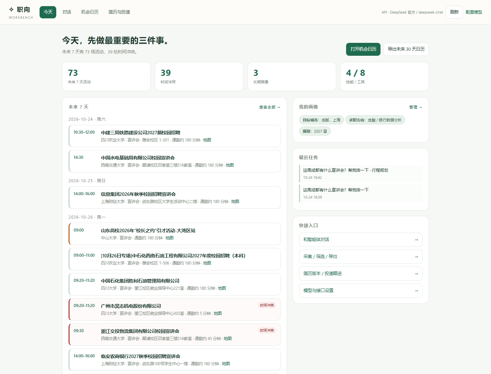
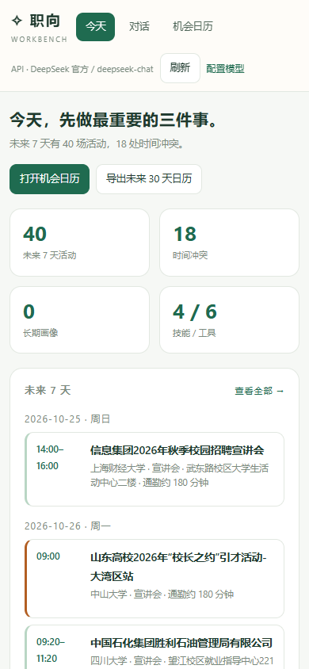

# 11 · 工作台（M9 已落地）

> 目标：打开就有"今天该做什么"，而不是先看到聊天框。
> 三个页面：**今天（工作台） / 对话 / 机会日历**，用统一导航连起来。

---

## 1. 路由

| 地址 | 页面 | 作用 |
| --- | --- | --- |
| `/` 或 `/today` | `src/web/workbench.html` | 今天：统计、未来 7 天、画像、任务、快捷入口 |
| `/chat` | `src/web/index.html` | 对话、模型设置、能力面板、记忆面板 |
| `/recruit` | `src/web/recruit.html` | 采集、信息源健康、完整行程、导出 |

首次打开 `/` 时，如果没登录，会显示登录提示并引导到 `/chat`；登录后回到 `/` 即可。

---

## 2. 今天页长什么样

- 顶部：四张统计卡（未来 7 天活动 / 冲突 / 画像条数 / 技能与工具数）；
- 左侧：未来 7 天行程，标出时间冲突、赶场风险、可能撤下、多源收录；
- 右侧：长期画像、最近任务、快捷入口；
- 顶部按钮：刷新、导出未来 30 天 `.ics`。

手机：

实测 390×844 视口：统计两列、行程单列、横向溢出 0 px。

---

## 3. 三条主路径（都不超过 3 步）

| 想做什么 | 步骤 |
| --- | --- |
| 看今天/这周有什么 | 打开 `/` → 未来 7 天 → 点来源 |
| 排完整行程并导出 | `/` → 机会日历 → 导出 `.ics` |
| 让智能体帮忙 | `/` → 对话 → 说需求（技能自动选择） |

---

## 4. 数据来源

工作台只读，不写数据：

| 区块 | 接口 |
| --- | --- |
| 统计 / 未来 7 天 | `GET /api/recruit/schedule?days=7` |
| 画像 / 任务 | `GET /api/memory` |
| 技能与工具 | `GET /api/capabilities` |
| 当前模型 | `GET /api/model` |
| 导出 | `GET /api/recruit/export.ics?days=30` |

未登录统一返回 401，工作台显示登录引导，不会白屏。

---

## 5. 导航

| 页面 | 导航 |
| --- | --- |
| 工作台 | 今天（选中）/ 对话 / 机会日历 / 简历与投递 |
| 对话 | 侧栏「▦ 今天 / 工作台」「▤ 招聘日历」「▥ 简历与投递」「⚙ 能力与记忆」「记忆与画像」 |
| 机会日历 | 顶部「← 今天」「对话」「简历」 |
| 简历与投递 | 今天 / 对话 / 机会日历 / 简历与投递（选中） |

---

## 6. 已知边界

- 「简历」「投递」两个 tab 还没放进来：等 M11 有简历版本库和投递表后再加，避免放空壳；
- 工作台不提供写操作，所有编辑仍在对话页（记忆、模型）或日历页（采集、复核）；
- M5 地图路径还没接，当前通勤仍是估算值。

---

## 7. 验证

- `/`、`/chat`、`/recruit` 均返回 200，标题与 token 注入正确；
- 未登录：工作台显示登录引导；
- 登录后：统计、未来 7 天、画像、任务全部渲染；
- 桌面与手机截图无 JS 报错；手机横向溢出 0；
- 对话页新增「今天 / 工作台」入口。
