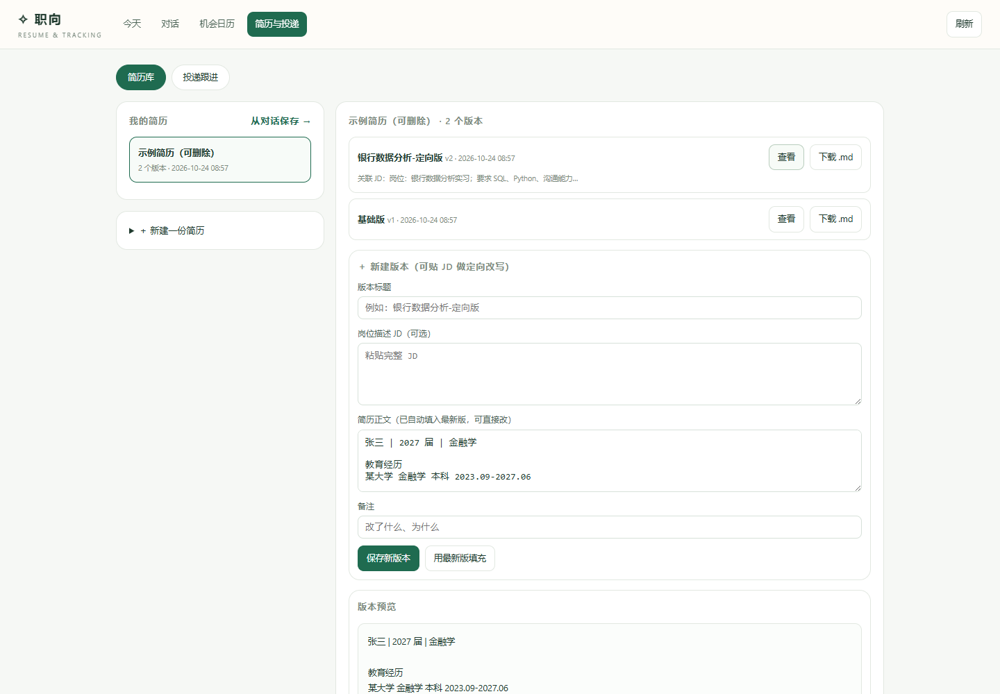
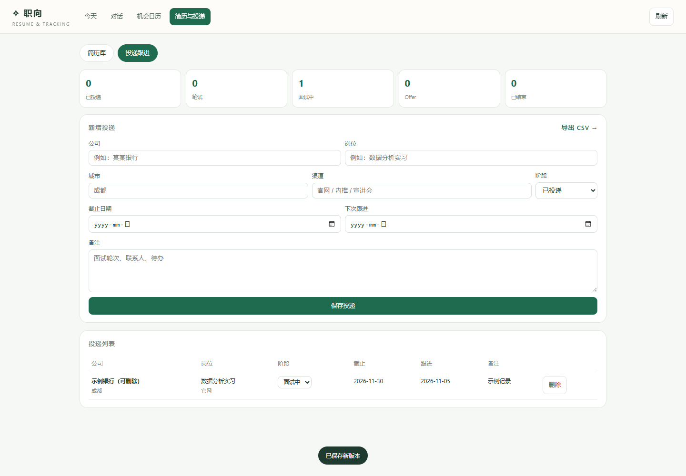
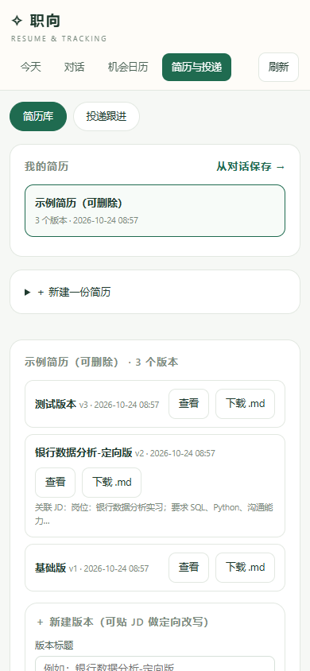

# 13 · 简历与投递（M11 第一版）

> 对应作业 3.1：按岗位定向改简历、准备面试。
> 这一版先解决"简历有地方存、版本能对比、投递能跟进"；面试题库和模拟面试在下一版。

---

## 1. 简历版本库



- 一份简历可以有多个版本：基础版 + 每个岗位一个定向版；
- 每个版本可带 **JD** 和备注，方便回看"当时为什么这么改"；
- 支持新建、查看、下载 `.md`、删除整份简历；
- 从对话生成的文稿可以一键存入：聊天里点「保存为简历」→ 自动进入 `/resume`。

数据结构：

```sql
resumes(id, name, is_base, created_at, updated_at)
resume_versions(id, resume_id, version_no, title, content, jd_text, notes, created_at)
```

---

## 2. 投递跟进



- 字段：公司、岗位、城市、渠道、阶段、截止日期、下次跟进、备注；
- 阶段：已投递 / 笔试 / 面试中 / Offer / 已结束；
- 表格里可直接改阶段，删除记录；
- 导出 CSV（Excel 可开）。

```sql
applications(id, company, role, city, channel, stage, deadline,
             next_followup, resume_version_id, jd_text, notes, created_at, updated_at)
```

---

## 3. 智能体怎么用这些数据

新增两个**只读**工具（能力面板可见）：

| 工具 | 作用 |
| --- | --- |
| `resume_list` | 列出简历与版本数 |
| `resume_read` | 读取某份简历最新版正文 + JD |

提示词要求：改简历前先读原文，只能基于原文改写，不得编造经历/数字/时间线。

**没有给模型写入权限**：保存版本由你点按钮完成（对话里的「保存为简历」、工作台的「新建版本」）。这是为了避免模型"自作主张写库"。

---

## 4. 接口

| 方法 | 路径 | 作用 |
| --- | --- | --- |
| GET | `/api/resumes` | 简历列表 + 统计 |
| POST | `/api/resumes` | 新建简历（含基础版） |
| GET | `/api/resumes/<id>` | 简历详情 + 所有版本 |
| POST | `/api/resumes/<id>/versions` | 新增版本 |
| POST | `/api/resumes/from-session` | 把对话文稿存为版本 |
| POST | `/api/resumes/<id>/delete` | 删除整份简历 |
| GET | `/api/applications` | 投递列表 + 阶段 |
| POST | `/api/applications` | 新增/更新投递 |
| POST | `/api/applications/<id>/delete` | 删除 |
| GET | `/api/applications/export.csv` | 导出 CSV |

数据存在 `%LOCALAPPDATA%\ZhiXiang\users\<id>\.data\resume.db`，与招聘库分开。

---

## 5. 页面与导航

- `/resume`：简历库 / 投递跟进两个 tab；
- 工作台导航新增「简历与投递」；对话侧栏新增「▥ 简历与投递」；日历页顶部也有入口；
- 手机 390×844 实测无横向溢出。



---

## 6. 验证

- 7 项简历/投递测试：创建、版本递增、校验、投递阶段、CSV、from-session、工具读取；
- 浏览器实测：1 份简历 2 个版本 → 新建版本变 3 个；投递表格 1 行；改阶段/删除正常；
- 对话文稿保存：从聊天点「保存为简历」→ 跳到 `/resume`，版本从 3 变 4；
- 能力面板：8 工具 / 4 技能（工具数增加 2）；
- 77 项测试通过，页面无 JS 报错。

---

## 7. 已知边界

- 不能删除单个版本（只能删整份简历）；
- 不支持 `.docx` 导出（当前 `.md`/纯文本）；
- 投递记录不能绑定到具体简历版本（字段已留 `resume_version_id`，界面下一版补）；
- 面试题库、模拟面试、复盘还没落库（M11 下半部分）；
- 没有自动投递、不会代发消息。
