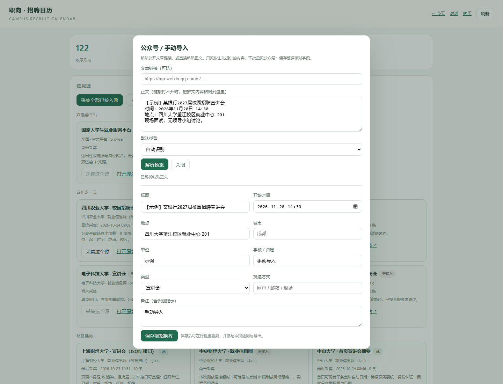

# 16 · 公众号 / 手动导入（1.2.1 + 1.4.1）

> 解决两件事：微信公众号推文没有稳定接口；就业指导/培训类信息不在现有源的列表里。
> 方案：**用户主动提供链接或正文 → 自动解析成草稿 → 人工核对 → 确认入库**。不批量抓公众号。

---

## 1. 为什么是"半自动"

- 公众号文章没有公开列表接口，批量抓取涉及登录态、版权与反爬；
- 高校就业网已经覆盖宣讲会/双选会，公众号多是补充（临时改期、学院专场、就业指导）；
- 用户主动转发的链接，只抓这一次，不建立公众号监控，风险最低。

---

## 2. 使用流程

1. 打开 `/recruit` → 点「＋ 公众号 / 手动导入」；
2. 粘贴文章链接，或直接粘贴推文正文；
3. 点「解析预览」→ 自动填标题、时间、地点、单位、类型、投递方式；
4. 核对/修改字段（识别不到的时间、地点会提示）；
5. 点「保存到招聘库」→ 进入活动日历、项目管理和导出。

全程不超过 5 步，手机上也能操作。

---

## 3. 能识别什么

| 字段 | 规则 |
| --- | --- |
| 标题 | 文章 `og:title` / 正文首行 |
| 日期 | `2026年11月5日`、`2026-11-05`、`11月5日`（补当前年） |
| 时间 | `14:30`、`14点`、`14时30分`；识别不到默认 09:00 并提示 |
| 地点 | `地点：…`、`在…举行` |
| 单位 | 标题中的公司/集团/银行名 |
| 类型 | 双选会 / 宣讲会 / 就业指导 / 招聘信息 / 其他；含“讲座/培训/简历门诊/生涯规划”判为就业指导 |
| 投递方式 | 网申 / 邮箱投递 / 现场投递 |
| 环节/面试类型 | 保存时从标题与正文提取（无领导、半结构、笔试等） |

识别不到就留空 + 提示，**不猜**。

---

## 4. 两类用途

### 1.2.1 微信公众号

- 链接可公开访问时，服务端只抓这一篇；
- 抓不到（需要验证/已删除）→ 页面提示，改为粘贴正文；
- 不保存整篇推文，只保存活动字段与识别提示，避免版权问题。

### 1.4.1 就业指导培训

- 类型选「就业指导」；
- 例如简历门诊、面试讲座、生涯规划工作坊；
- 同样进入行程、日历导出，不会和宣讲会混在一起（类型字段区分）。

---

## 5. 接口

| 方法 | 路径 | 作用 |
| --- | --- | --- |
| POST | `/api/recruit/manual/parse` | 解析链接/正文，返回草稿，不写库 |
| POST | `/api/recruit/manual/save` | 用户确认后写入招聘库 |

保存后：`sourceId = manual`，置信度 0.7，备注含“手动导入/手动确认”。

---

## 6. 验证

- 6 项测试：日期/时间/地点/类型、就业指导识别、公众号 HTML 标题正文、正文过短、API 解析→保存、缺时间拒绝；
- 浏览器实测：粘贴正文 → 解析 → 保存 → 行程出现该活动，面试标签正确；
- 截图：对话框 + 草稿字段；
- 全程不写库，直到点「保存」。

---

## 7. 边界

- 一篇文章默认生成一条活动；多场活动需要分次导入；
- 不自动监控公众号更新；
- 链接抓取失败时只能粘贴正文；
- 不做 OCR（图片版推文需要手动摘录）。
