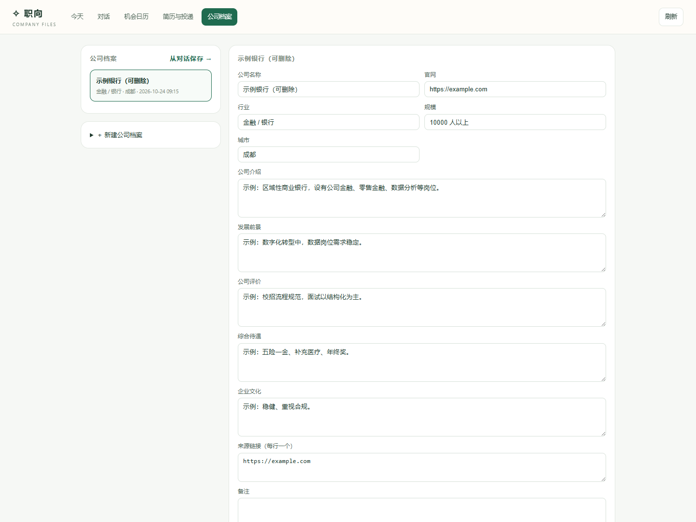

# 17 · 公司档案（2.2）

> 把"公司调研"从一次性对话变成可保存、可编辑、可关联活动的档案。



---

## 1. 为什么单独做

之前公司调研只在对话里生成一段 Markdown，关掉对话就散了；投递时想再看一眼公司待遇、面试风格，只能重新问。
现在调研结果落到 `company.db`，并与招聘活动、投递记录按公司名关联。

---

## 2. 字段

```sql
companies(
  id, name UNIQUE, industry, size, city, website,
  summary,       -- 公司介绍
  prospects,     -- 发展前景
  reputation,    -- 公司评价
  compensation,  -- 综合待遇
  culture,       -- 企业文化
  sources_json,  -- 来源链接（最多 20 条）
  notes, created_at, updated_at
)
```

- 按公司名去重：同名保存会合并更新；
- 只传部分字段时保留原值；显式传空字符串才清空；
- 来源只存链接与标题，不存整页正文。

---

## 3. 页面

`/companies`：

- 左侧公司列表；右侧编辑档案；
- 关联招聘活动：招聘库里公司名匹配的活动；
- 关联投递：投递记录里公司名匹配的岗位与阶段；
- 新建、删除、来源链接（每行一个）。

从日历卡片点公司名，会跳到 `/companies?name=公司名`，有档案就打开，没有就预填新建表单。

---

## 4. 从对话保存

聊天生成公司调研文稿后，点「保存为公司档案」：

- 标题去掉「公司调研/公司简报」前缀作为公司名；
- 正文存入 `summary`；
- 跳到 `/companies`，可继续补行业、待遇、评价、来源。

---

## 5. 智能体工具

新增两个只读工具（能力面板现在 12 个）：

| 工具 | 作用 |
| --- | --- |
| `company_list` | 列出本机公司档案 |
| `company_read` | 按 id 或公司名读取档案（含来源） |

提示词：先查本机档案；没有再用 `company-research` 技能调研，并提示用户可以保存。

---

## 6. 接口

| 方法 | 路径 | 作用 |
| --- | --- | --- |
| GET | `/api/companies` | 列表 + 统计 |
| GET | `/api/companies/<id>` | 档案 + 关联活动/投递 |
| POST | `/api/companies` | 新建/更新（按 id 或名称） |
| POST | `/api/companies/from-session` | 从对话文稿保存 |
| POST | `/api/companies/<id>/delete` | 删除 |

---

## 7. 关联规则与边界

- 关联靠**公司名包含匹配**（忽略空格、大小写），不是工商 ID；
- 简称/全称不一致时可能关联不上（如"某银行" vs "某银行成都分行"）；
- 不会自动抓取公司信息，调研仍由技能 + 搜索工具完成；
- 档案只在本机，不进 Git。

---

## 8. 验证

- 4 项测试：创建/同名合并/来源/删除、从对话保存、关联活动与投递、工具读取；
- 浏览器实测：示例银行档案显示 1 条关联投递；从对话保存后列表 2 条并自动打开；
- 页面无 JS 报错；
- 全量测试 109 项。
