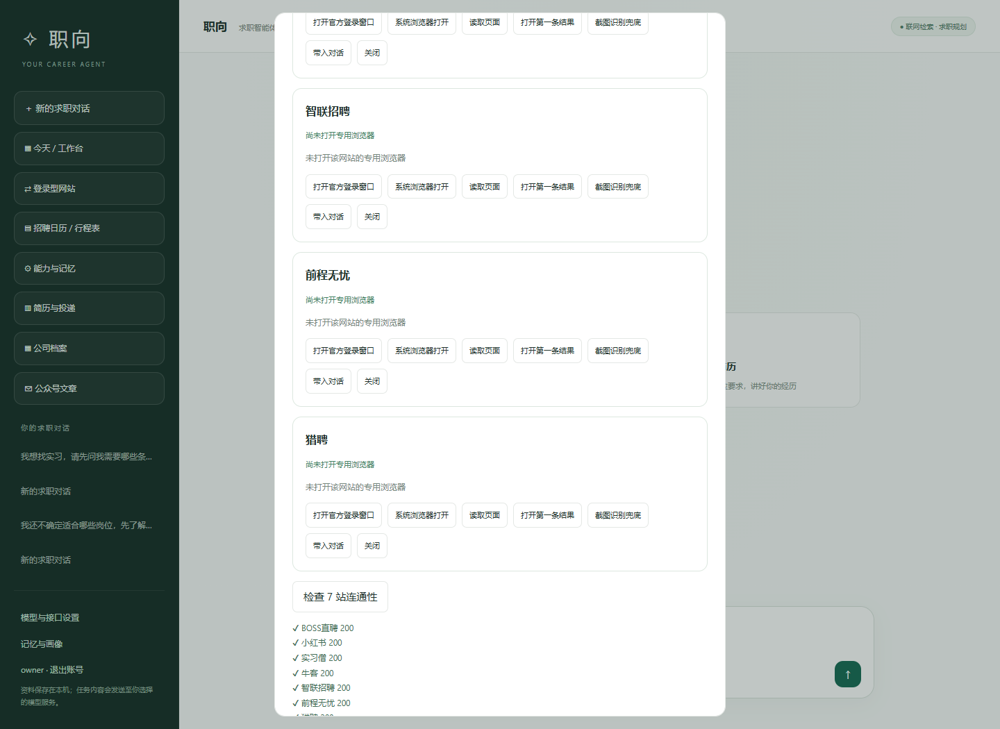

# 19 · 登录型网站与公众号（2026-10-25）

> 对应新需求 1、2、4：登录型网站统一入口、BOSS about:blank 修复、截图 OCR 兜底、公众号记录。
> **2026-10-25 更新**：公众号已并入 `/recruit?tab=sources`，`/wechat` 仅保留 302；来源表按学校行展示账号。
>
> **v3.2.1**：文章抓取支持 HTTP → Edge 渲染 → 粘贴；来源页可 harvest `mp.weixin.qq.com` 链接；Sogou/微信验证仍不绕过。
>
> **Tooling**：BrowserSkill CLI 0.3.3 已安装到 `%USERPROFILE%\.local\bin\bsk.exe`；daemon 由持久终端运行。扩展需在 Edge/Chrome 手动加载并显示 connected。

---

## 1. 登录型网站：从 2 个扩到 7 个

| id | 网站 | 类型 | 搜索页 |
| --- | --- | --- | --- |
| `boss` | BOSS直聘 | 岗位 | `/web/geek/job` |
| `xiaohongshu` | 小红书 | 笔记 | `/search_result` |
| `shixiseng` | 实习僧 | 实习 | `/interns` |
| `nowcoder` | 牛客 | 岗位/讨论 | `/search` |
| `zhaopin` | 智联招聘 | 岗位 | `sou.zhaopin.com` |
| `51job` | 前程无忧 | 岗位 | `we.51job.com` |
| `liepin` | 猎聘 | 岗位 | `/zhaopin` |

注册表：`src/platform/sites.mjs`。每个站点声明首页、域名、搜索 URL、结果选择器、详情路径、可读路径。
侧栏「登录型网站」一次性列出全部站点，打开、读取、**打开第一条结果（元素点击）**、截图识别、带入对话、关闭都在同一面板，另有「检查 7 站连通性」。

---

## 2. BOSS about:blank：原因与修复

实测现象：打开后先到 `zhipin.com`，约 3 秒后页面变成 `about:blank`。

两个原因叠加：

1. Edge 首次启动会弹“同步确认 / 权限提示”对话框，可能抢占页面；
2. BOSS 检测到自动化浏览器后，把页面清空。

修复：

- 启动参数：`--disable-sync --no-first-run --no-default-browser-check --deny-permission-prompts` 等；
- 关闭 `edge://permission-request-dialog` / `edge://sync-confirmation-dialog`；
- **优先选本站域名页面**，而不是“第一个非空白页”；
- 监听 `framenavigated`：一旦跳 `about:blank`，自动重新导航回首页；
- `status` 检测到空白也会尝试恢复，不再把 about:blank 当成正常；
- 仍被拦截时提供「系统浏览器打开」：用普通 Edge 打开同一站点，用户自己登录/阅读，再用「手动导入」记录。

> 结论：BOSS 这类强风控站点，不保证自动化窗口持久可读；现在至少不会卡在 about:blank，且会给出可用的替代路径。

---

## 3. 截图 OCR 兜底

DOM 读取失败（正文过少、风控页、渲染未完成）时：

1. Playwright 截当前页面 → `platform-screenshots/<site>.png`；
2. 调用 Windows 自带 `Windows.Media.Ocr`（`scripts/ocr.ps1`）；
3. 返回 `ocr_readable` + 文字 + 截图链接；OCR 不可用则返回 `needs_manual` + 截图。

UI 的「截图识别兜底」按钮可随时手动触发；「打开第一条结果」会点击当前搜索结果的第一条详情，点击失败则自动转 OCR；截图通过 `/api/platform/screenshot/<site>` 查看。

限制：OCR 有识别误差；截图只保存在本机，不作为平台事实。

---

## 4. 公众号

- 种子账号 9 个（西财就业、西南交大就业、上财就业、川大/川农/电子科大/西南石油/南开/中山就业），biz 来自公开搜索结果；
- `/wechat`：账号列表、文章记录、链接导入、正文粘贴、添加公众号；
- 导入时先抓文章；微信经常返回验证页（正文 < 120 字），此时**要求粘贴正文**，不保存垃圾记录；
- 文章记录存标题、链接、发布时间、摘要、正文（截断）、关联活动 id；
- 解析出的活动草稿可在页面确认后保存到招聘库，并回写 `event_id`；
- 不做批量监控、不抓登录态。

数据：`wechat.db`（accounts/articles），与招聘库分开。

---

## 5. 接口与工具

| 方法 | 路径 | 作用 |
| --- | --- | --- |
| GET | `/api/platform/status` | 7 个站点状态 |
| POST | `/api/platform/open/close/read/search` | 打开/关闭/读取/搜索 |
| POST | `/api/platform/ocr` | 截图 OCR |
| POST | `/api/platform/external` | 系统浏览器打开 |
| GET | `/api/platform/screenshot/<site>` | 最新截图 |
| GET | `/api/wechat/accounts` | 账号 + 最近文章 |
| POST | `/api/wechat/articles/import` | 链接/正文导入 |
| POST | `/api/wechat/articles/<id>/link` | 关联活动 |

工具 `career_platform_status/search/read` 的 `platform` 枚举已扩展到 7 个站点。

---

## 6. 验证

- 平台注册表 7 项、URL 白名单/搜索/路径测试通过；
- 小红书打开后可读到 1672 字；
- BOSS 打开后 3 秒不再显示 about:blank（watchdog 恢复）；
- OCR 实测可识别工作台截图中文；XHS 点击结果被登录层遮挡时，自动转 OCR 并返回 241 字；
- 7 站首页连通性检查：7/7 返回 200；
- 公众号：9 个种子账号；真实文章链接要求验证时返回 `needPaste`；粘贴正文后成功记录并解析出双选会草稿；
- 全量测试含平台/公众号套件。
