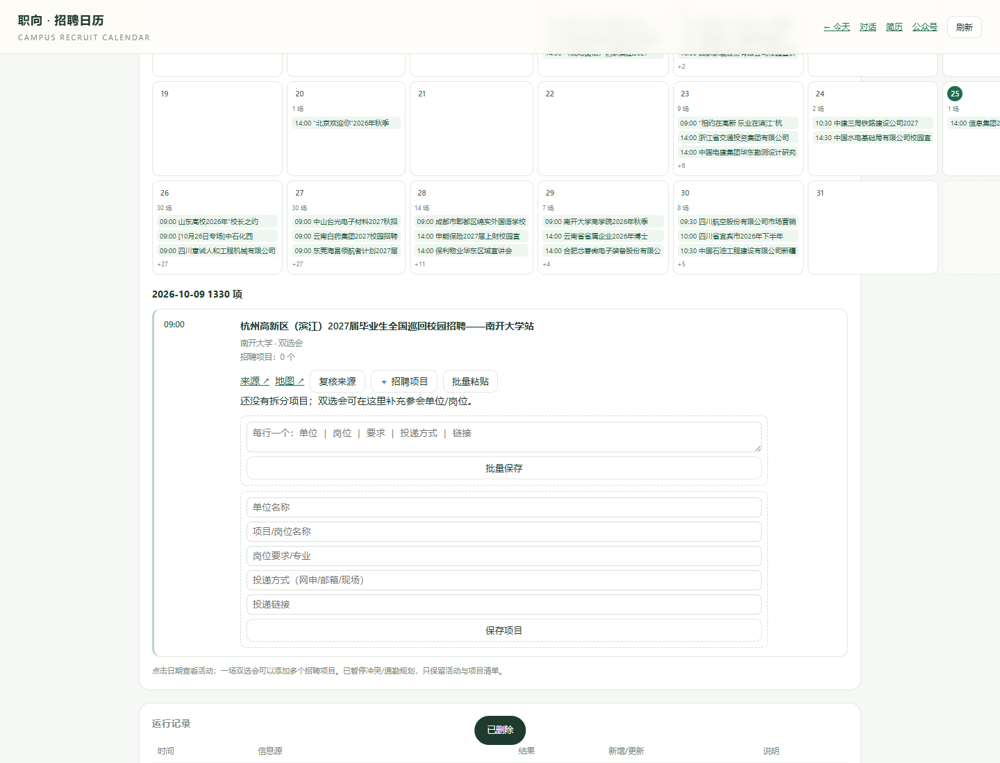

# 20 · 活动日历与招聘项目（一对多）

> 对应新需求 3、5：暂停行程规划；活动与具体招聘项目一对多，用日历看板呈现。



---

## 1. 为什么改

一场双选会往往有几十家单位、上百个岗位；之前的 `events` 一行只能放一个单位，双选会只能写成“某校双选会”，具体项目丢失。

现在：

```
event（活动：双选会/宣讲会）
  └─ event_projects（招聘项目：单位 + 岗位 + 要求 + 投递）
```

一条活动可以有 0…N 个项目；项目独立增删，不影响活动本身。

---

## 2. 数据结构

```sql
event_projects(
  id, event_id, company, title, positions, requirements,
  apply_mode, apply_url, source_url, notes, created_at, updated_at
)
```

- `event_id` 必须存在；
- 单位和项目名称至少填一项；
- 项目随活动展示，不参与活动生命周期/缺失标记；
- 旧库启动时自动建表。

---

## 3. 日历看板

`/recruit` 顶部改为月历：

- 周一到周日 7 列，每天显示活动数量与前 3 场；
- 点击日期，下方显示当天活动卡片；
- 每张活动卡片显示“招聘项目 N 个”，可展开项目列表；
- 「＋ 招聘项目」内联表单：单位、项目/岗位、要求、投递方式、投递链接；
- 「批量粘贴」：每行 `单位 | 岗位 | 要求 | 投递方式 | 链接`，一次导入多个项目；
- 项目可删除；
- 月份切换、今天、导出 ICS/CSV/MD。

工作台：

- 统计卡改为「未来 7 天活动 / 招聘项目 / 长期画像 / 技能与工具」；
- 未来 7 天列表显示项目数量；
- 不再显示“时间冲突 / 通勤”。

---

## 4. 暂停行程规划

按新需求暂时移除：

- 删除 `schedule-planner` 技能（技能数 4 → 3）；
- 页面不再调用 `schedule` 接口，不再显示冲突/赶场/通勤；
- 工具 `career_recruit_events` 改为按日历列活动 + 项目，不再生成冲突/通勤；
- 导出 ICS/CSV/MD 保留（它们是“日历/清单”，不是排班规划）；
- 地点仍带高德地图链接，方便自行导航。

---

## 5. 接口

| 方法 | 路径 | 作用 |
| --- | --- | --- |
| GET | `/api/recruit/calendar?month=YYYY-MM` | 月历数据（活动 + 项目） |
| GET | `/api/recruit/events?days=7` | 时间范围活动（含 projects） |
| POST | `/api/recruit/projects` | 新增/更新项目 |
| POST | `/api/recruit/projects/<id>/delete` | 删除项目 |

---

## 6. 边界

- 项目目前由人工添加，尚未从双选会详情页自动拆解；
- 日历只显示有活动的日期，空白天不显示；
- 导出 CSV 仍是“一行一场活动”，项目数在页面上看；
- 行程冲突/通勤功能是暂停，不是删除数据。
