# 外部 Agent 配置与连接状态 · 原型（#24）

> Wayfinder 票 [#24](https://github.com/Lumichelka/career-agent/issues/24)，父地图 [#12](https://github.com/Lumichelka/career-agent/issues/12)。
> 状态：**原型候选，尚未选定**（2026-10-26）。静态 mock，不接后端、不改正式代码；三个形态等真人拍板。
> 契约依据：[#13 MCP 客户端与外部 Agent 适配契约](https://github.com/Lumichelka/career-agent/issues/13)（[docs/plan/21](https://github.com/Lumichelka/career-agent/blob/main/docs/plan/21-MCP%E5%AE%A2%E6%88%B7%E7%AB%AF%E4%B8%8E%E5%A4%96%E9%83%A8Agent%E9%80%82%E9%85%8D%E5%A5%91%E7%BA%A6.md)）、[#14 多用户隔离](https://github.com/Lumichelka/career-agent/issues/14)、[#18 工作流抽屉](https://github.com/Lumichelka/career-agent/issues/18)、[#21 入站位置](https://github.com/Lumichelka/career-agent/issues/21)、[#22 聚合/转发](https://github.com/Lumichelka/career-agent/issues/22)。

## 决定（待真人选定）

本票只问「放哪、怎么分级、手机上怎么退化」，契约与错误码都已由 #13 定死。三个形态共用同一套内容，差别只在位置：

- **A · 设置页**：配置、状态、工具、MRTR 全在现有「模型与接口设置」对话框里；对话页只留一个入口提示。
- **B · 工作流抽屉**：全部进 #18 的右侧抽屉（手机底部抽屉）；设置只留模型，连接编辑在抽屉里的第二层。
- **C · 两处分工**：设置只管配置（名称、传输、凭据、开关、MRTR）；抽屉管运行时（状态、工具、测试、刷新）。

待答：选哪个形态；手机上是全屏设置、底部抽屉还是两屏；以及「测试连接 / 刷新工具」这些运行按钮该不该出现在配置那侧。

## 在问什么

1. 新增 / 编辑外部 Agent：名称、transport（stdio 命令 + 参数 / HTTP URL）、凭据（env / header / token）、启用开关；stdio 仅 owner，成员只看到 HTTP。
2. 连接状态：未连接 / 连接中 / 已连接（显示协商到 modern 还是 legacy）/ 失败（错误码 + 恢复建议）/ 已回收；显示最近连接时间。
3. 工具列表：发现到的工具（`mcp__<agent>__<tool>`、只读 / 写、来源）、刷新、测试连接（只 connect + 发现，不调用工具）。
4. MRTR：sampling / elicitation 开关，默认开；首次采样前费用提示。
5. 空 / 失败状态：没有 Agent、发现失败、凭据无效、协商失败、排队中。
6. 位置与退化：设置页还是工作流面板；手机端如何退化。

## 怎么跑

双击 `index.html` 即可（无构建、无依赖、无外部请求）。或在仓库根：

    python -m http.server 8765
    # 打开 http://127.0.0.1:8765/prototype/agent-config/?variant=A

- 顶栏：切 **A / B / C**、切演示状态（modern、legacy、回收、连接中、未连接、排队、四种失败、没有 Agent）、切 **owner / 成员**。
- 链接参数（也用于截图）：`?variant=A|B|C&state=modern|legacy|recycled|connecting|idle|queued|failed-auth|failed-connect|failed-negotiation|discovery-failed|empty&owner=1|0`；
  再加 `screen=detail`（A 手机进详情）、`pane=config`（A 直接看配置）、`view=detail`（B/C 进 Agent 详情）、`edit=1`（B 打开编辑层）、`settings=1`（C 打开设置）。
- 手机宽度：DevTools 设 390×844；A 是全屏设置（列表 → 详情），B/C 是底部抽屉（76vh）+ 详情；抽屉里再打开编辑层是全屏。
- 「说明」按钮里有同一段三形态说明。

## 三个变体（结构不同，不是换皮）

| | A · 设置页 | B · 工作流抽屉 | C · 两处分工 |
| --- | --- | --- | --- |
| 配置（transport / 凭据 / 开关 / MRTR） | 设置对话框内 | 抽屉里第二层「编辑配置」 | 设置对话框内 |
| 连接状态 / 工具 / 测试 / 刷新 | 同一对话框的「状态与工具」页 | 抽屉的 Agent 详情 | 抽屉的 Agent 详情 |
| 从对话页怎么到 | 左下「模型与接口设置」 | 顶部「工作流」→「外部 Agent」 | 状态在「工作流」，配置在设置 |
| 手机 | 设置全屏；列表 → 详情（有返回） | 底部抽屉 76vh；详情仍在抽屉里，编辑层全屏 | 底部抽屉看状态；改配置跳全屏设置 |
| 赌的是 | 外部 Agent 是「设置」的一种，配置和调试不该分开 | 连接状态是运行时信息，应该贴着任务看 | 配置低频、运行高频，分开各自更轻 |

## 状态怎么验

| 要验的 | 点哪里 |
| --- | --- |
| 未连接 / 启用但从未连接 | 顶栏状态选「未连接」 |
| 连接中（探测时代） | 选「连接中」；或点「测试连接」看 1 秒过渡 |
| 已连接 modern / legacy | 选「已连接 · modern / legacy」；legacy 会多一行回退说明 |
| 失败 · AUTH_FAILED / CONNECT_FAILED / ERA_NEGOTIATION_FAILED | 顶栏对应项；状态卡给错误码 + 恢复建议 + 重试 / 更新凭据 |
| 工具发现失败 | 选「工具发现失败」；连接失败与「空工具列表」分开说 |
| 排队中 | 选「排队中」；在途 2/2、等待 38s / 上限 120s |
| 已回收 | 选「已回收」；显示空闲 30 分钟回收、缓存与重连规则 |
| 没有 Agent | 选「没有 Agent」 |
| 工具列表 / 刷新 | 详情页「刷新」（未连接时提示不可用） |
| 测试连接（只连不调工具） | 详情页「测试连接」；成功后只刷新连接与工具，不调用工具 |
| MRTR 开关 | 配置页 / B 详情里；关闭后提示上游请求会被拒（UNSUPPORTED） |
| 首次采样费用提示 | 配置页或 B 详情里「首次采样提示」 |
| 成员看不到 stdio | 顶栏身份切「成员」；列表只剩 HTTP，表单 transport 只剩 HTTP |
| 390 不横向溢出 | 脚本断言 `scrollWidth === 390`（见 `shots.mjs`） |

## 已遵守的上游决议

- **#13**：每 `(user, agent)` 一条懒连接、空闲 30 分钟回收；并发每用户 2 / 全局 8、排队上限 120s；发现缓存 10 分钟 + 任务快照；工具名 `mcp__<agentId>__<toolName>`；测试连接只 connect + 发现；MRTR 默认开、首次采样前提示费用；错误码与恢复建议照 §8.3；发现失败即连接失败、不返回半截列表；stdio 仅 owner、子进程不继承服务器密钥；URL 与 token 只存 vault、界面不显明文。
- **#14**：成员只看到 HTTP；stdio 永久 owner-only；每用户独立数据根与 KeyVault。
- **#18**：入口是右侧抽屉（手机底部抽屉），不新增一级「工作流」页面；B/C 只借用这个抽屉，不新建导航。
- **#21 / #22**：入站 `/mcp` 与转发是另外的面，本原型不碰。

## 演示数据

- **Claude Code**（stdio，owner）：`claude mcp serve`，modern，5 个工具（3 只读 / 2 写）。
- **Dify · 简历助手**（HTTP）：已回收，legacy，8 个工具；URL 只显示 `https://dify.example.com/mcp…`。
- **Coze**（stdio）：`uvx coze-mcp-server`，AUTH_FAILED（`COZE_API_TOKEN` 失效），0 工具。
- 数字与状态都是演示数据，重点看密度、层级与文案，不是账目。

## 已知限制 / 留给 /to-spec

- 表单只做了最小闭环：HTTP 自定义 header 名有一行输入，但没有做「Bearer / 自定义 header」的切换联动；`enable` 关掉后的回收提示只有一句文案。
- elicitation 的表单弹窗属于聊天页（#13 §9），不在本票；这里只放开关与说明。
- 首次采样提示只做「允许本次 / 不允许」两个按钮；是否需要「本任务不再询问」没画（契约说每个 Agent 首次一次）。
- 未做 Agent 删除的二次确认、名称冲突校验的表现（只在文案里写「用户内唯一」）。
- 没有持久化；保存 / 删除只改内存；刷新与测试连接是定时器模拟。
- 手机截图由 390×844 真实视口导出；每张都断言无横向溢出。

## 截图

| A · 设置页（桌面，modern） | A · 配置（桌面，stdio） |
| --- | --- |
| 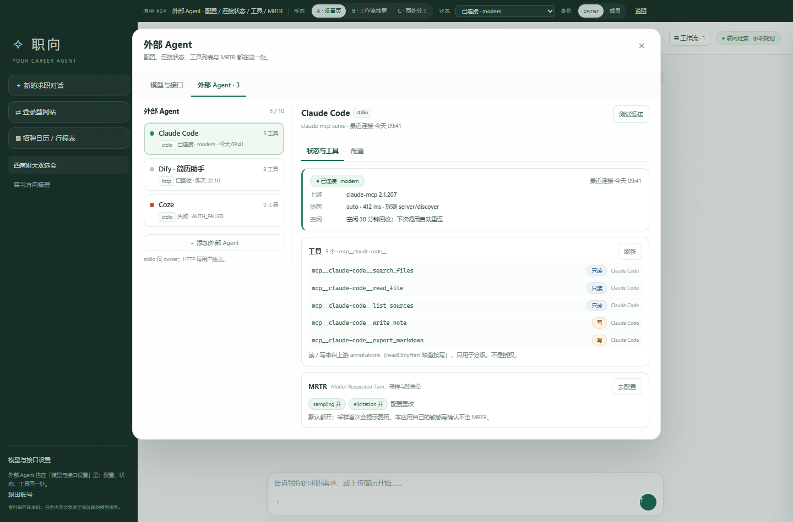 | 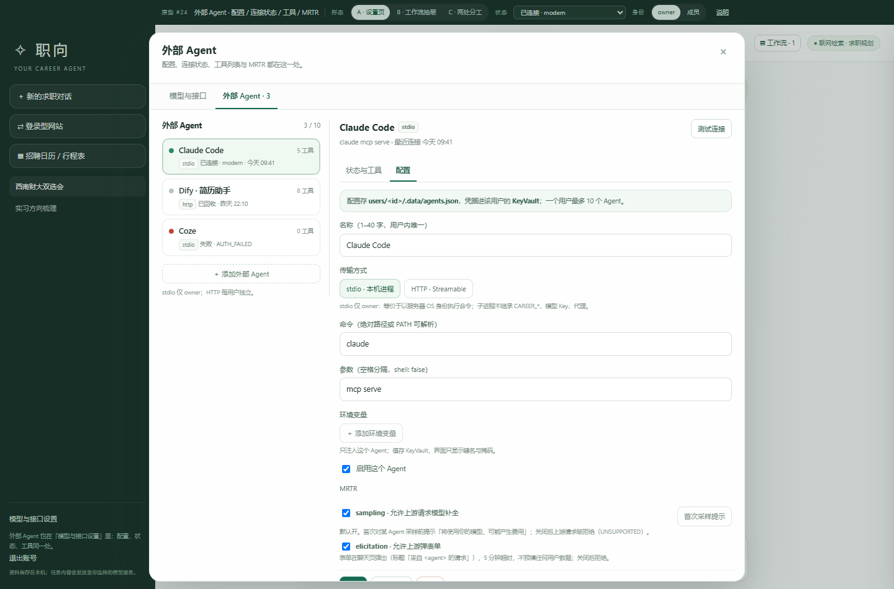 |

| A · 配置（桌面，HTTP · Dify） | A · 失败 · AUTH_FAILED |
| --- | --- |
| 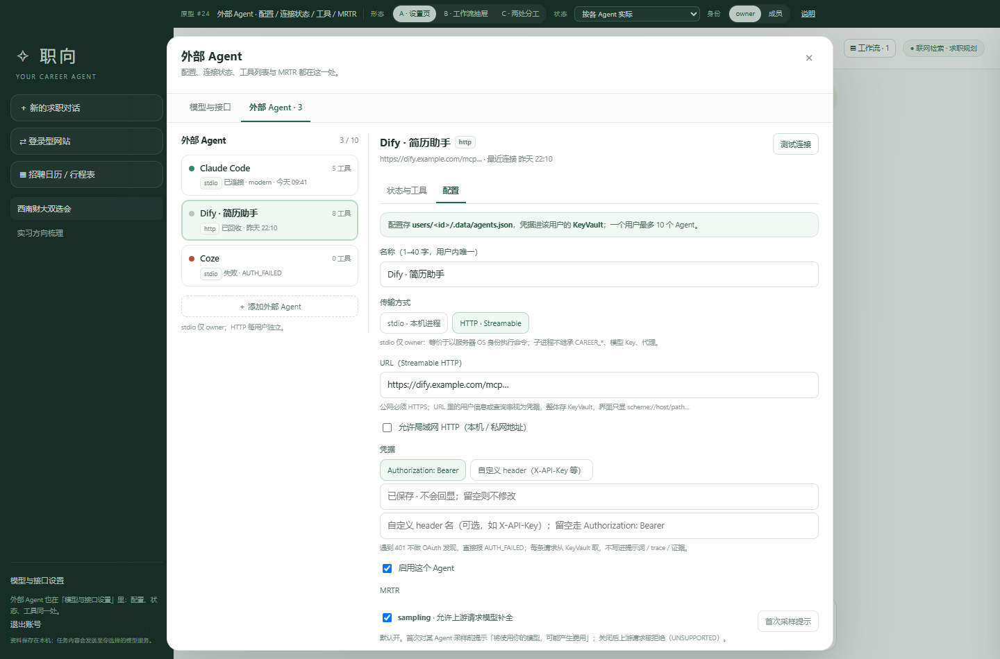 | 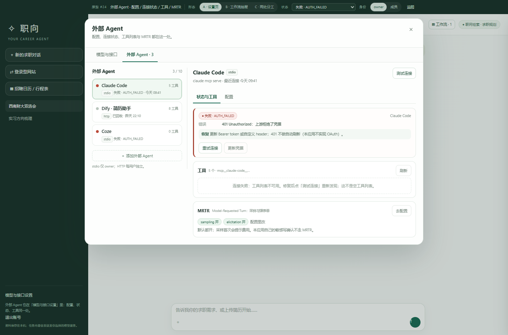 |

| A · 没有 Agent | A · 手机列表（390×844） |
| --- | --- |
| 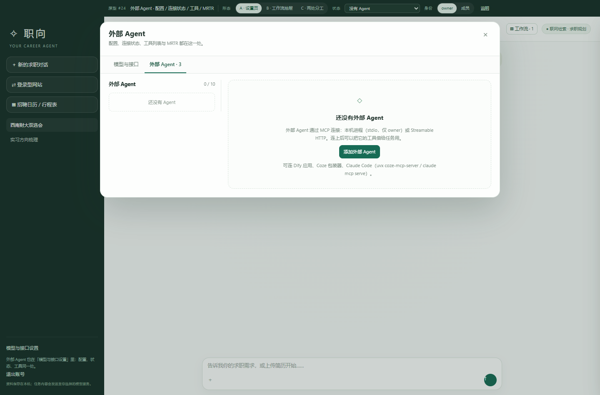 | 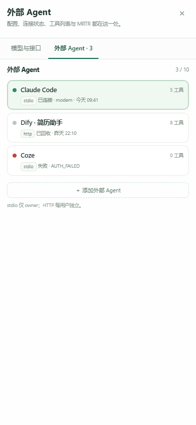 |

| A · 手机详情（390×844） | B · 抽屉（桌面，按各 Agent 实际） |
| --- | --- |
| 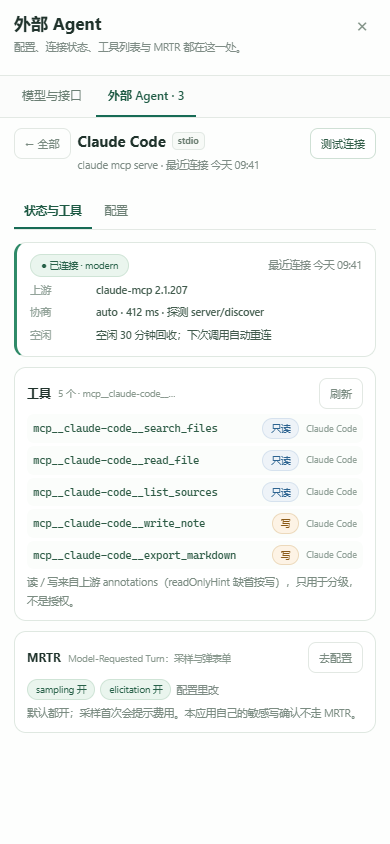 | 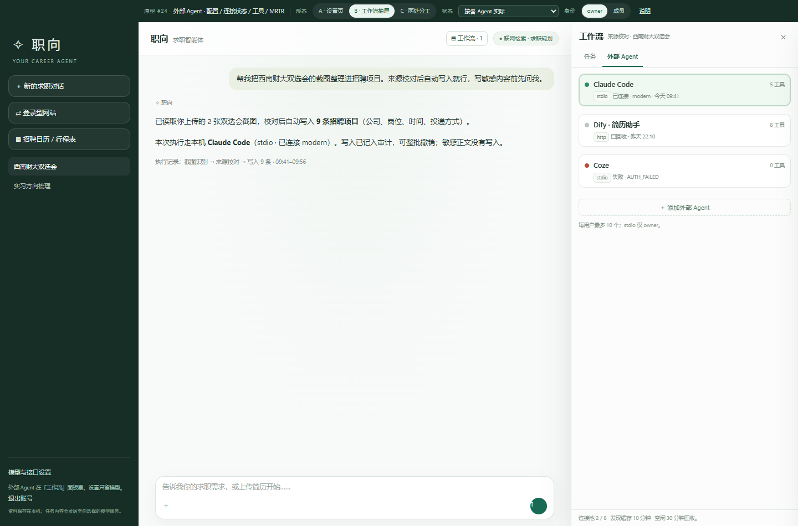 |

| B · 工具发现失败 | B · 编辑配置层（桌面） |
| --- | --- |
| 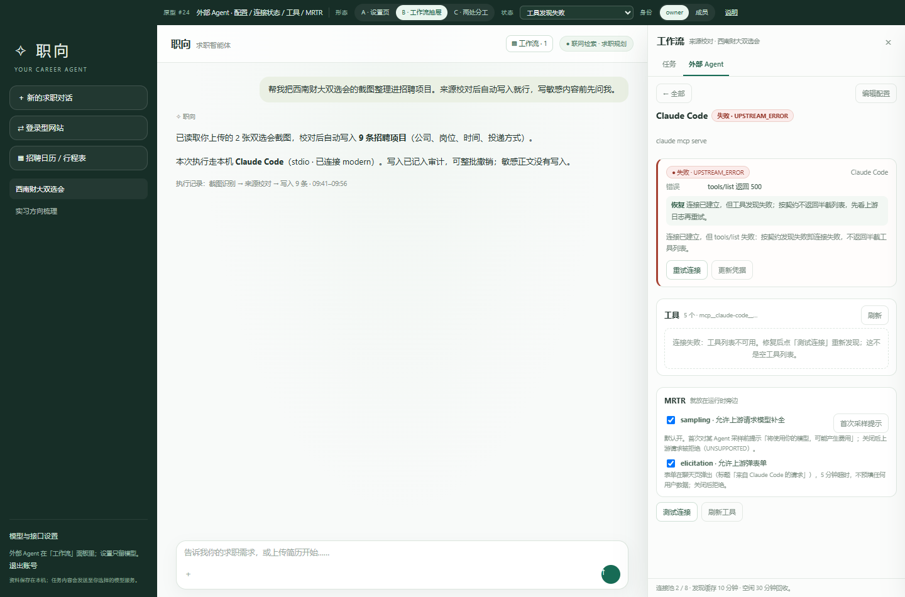 | 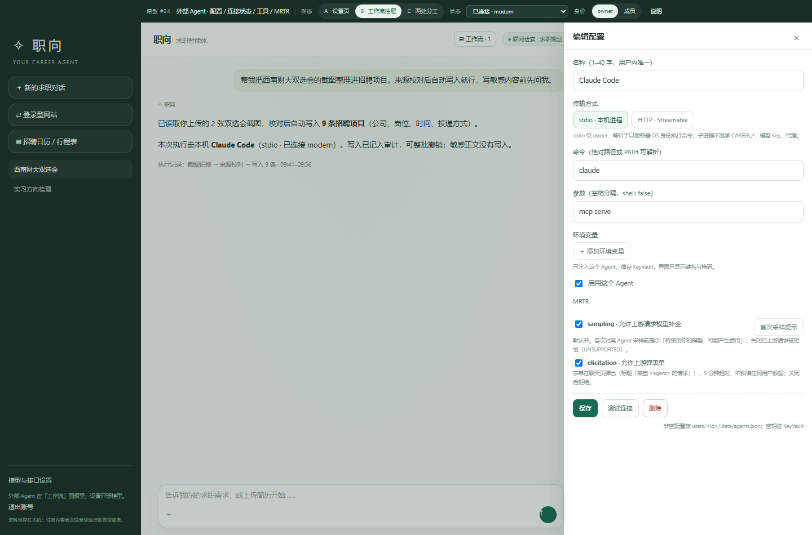 |

| B · 手机详情（390×844） | C · 抽屉运行时（排队中） |
| --- | --- |
| 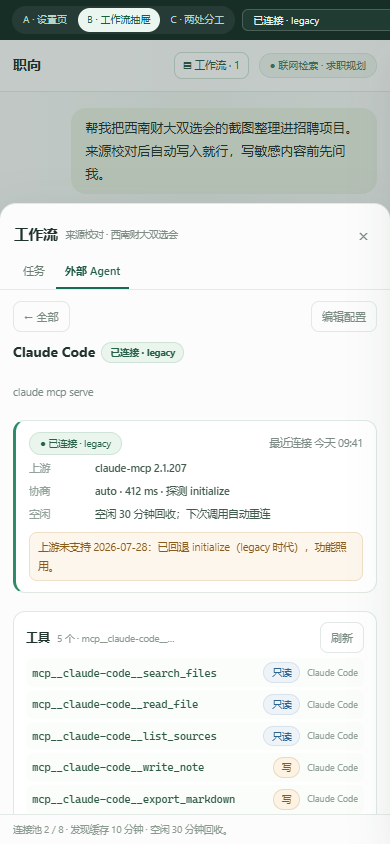 | 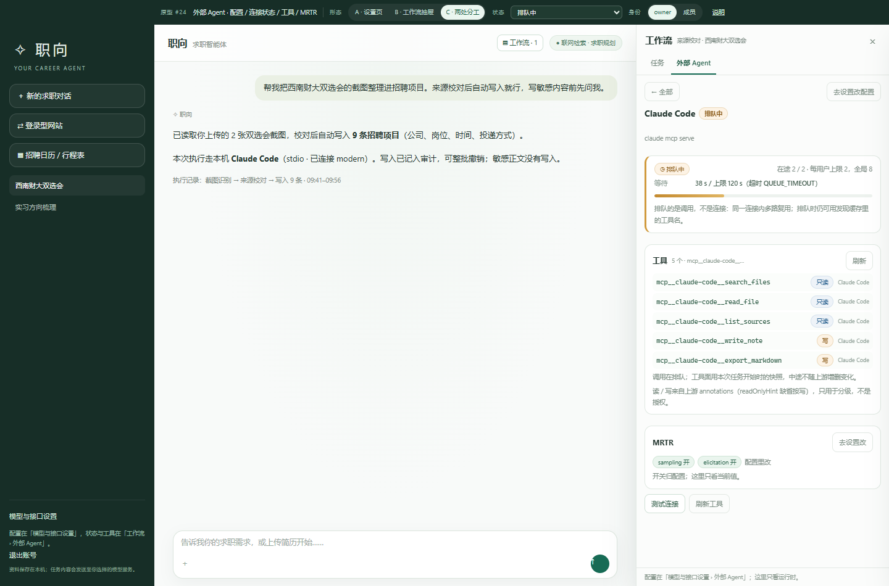 |

| C · 设置只放配置 | C · 手机（已回收，390×844） |
| --- | --- |
| 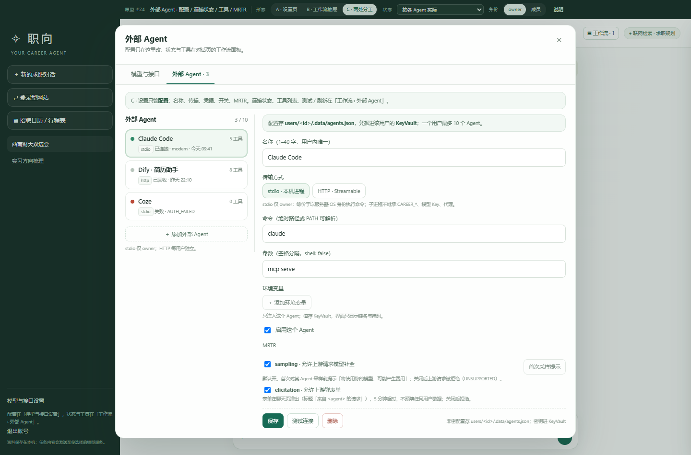 | 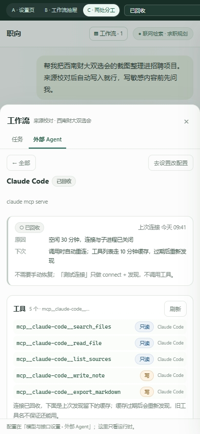 |

## 文件

- `index.html`：全部内容（CSS / JS 内联）。
- `shots.mjs`：Playwright 截图脚本（用系统 Chrome，`node prototype/agent-config/shots.mjs`）。
- `screenshots/`：上表截图，桌面 1440×950、手机 390×844。
