# 审计与撤销面板 · 原型（#23）

> Wayfinder 票 [#23](https://github.com/Lumichelka/career-agent/issues/23)，父地图 [#12](https://github.com/Lumichelka/career-agent/issues/12)。
> 状态：**原型，不是实现**。静态 mock，不接后端、不改正式代码。
> 依据：[#15 审计与批量撤销模型](https://github.com/Lumichelka/career-agent/issues/15) + [#18 工作流面板结论](https://github.com/Lumichelka/career-agent/issues/18)。

## 待拍板（2026-10-26）

> 真人选定后把结论写在这里，再决定 /to-spec 怎么落。

## 在问什么

在 #15 已定的模型之上，审计 / 撤销面板在桌面与手机上如何呈现？六件事：

1. 按批次分组的审计列表；
2. 批次内新旧值 diff 的展开方式；
3. 撤销结果（已撤销 N / 冲突 M / 跳过 K 批）的就地呈现；
4. 任务详情里的「撤销本任务全部自动写入」入口；
5. 冲突条的「强制撤销」二次确认；
6. 390×844 手机宽度下不横向溢出。

## 怎么跑

双击 `index.html` 即可（无构建、无依赖、无外部请求）。或在仓库根：

    python -m http.server 8765
    # 打开 http://127.0.0.1:8765/prototype/audit-panel/?variant=A

- 顶栏 / 方向键切换 **A / B / C**；「重置」回到任务卡。
- 状态可直接分享（也用于截图）：`?variant=A|B|C&state=task|list|detail|conflict|forced|confirm`。
  `task` 任务卡 · `list` 审计列表 · `detail` 批次详情 · `conflict` 整任务已撤销后的冲突 · `forced` 强制撤销后 · `confirm` 强制撤销的二次确认弹窗。
- 手机宽度：DevTools 设 390×844（截图即该视口）；抽屉在手机上变底部抽屉（72vh）。

## 三个变体（结构不同，不是换皮）

| | A · 抽屉内下钻 | B · 独立审阅层 | C · 任务内就地展开 |
| --- | --- | --- | --- |
| 审计放在哪 | #18 的 400px 工作流抽屉里，任务卡 → 审计列表 → 批次详情，逐级返回 | 从抽屉弹出一个 1000px 审阅层：左批次、右 diff，两栏同时看 | 不另开面板：批次与 diff 直接挂在任务卡下面 |
| 批次列表 | 一列卡片，点进详情 | 左栏列表 + 筛选 chips，右栏详情 | 任务卡下的手风琴，一次展开一批 |
| diff 怎么展开 | 实体折叠，展开后字段「旧 → 新」纵向堆叠，原始 JSON 再折叠一层 | 右侧宽表「字段 / 旧值 / 新值」直接铺开，原始 JSON 按实体折叠 | 同 A 的纵向堆叠，但实体默认展开、不再下钻 |
| 撤销结果 | 批次头上就地变「已撤销 N / 冲突 1」 | 顶部 sticky 汇总条 + 列表与详情同时更新 | 手风琴头上就地变 chip，冲突条紧贴批次 |
| 任务级撤销 | 任务卡 + 审计页头两处 | 审阅层页头 | 任务卡里的审计区头 |
| 手机 | 底部抽屉内下钻，返回靠「← 全部批次」 | 全屏层，列表 → 详情；详情顶部返回 | 同一个底部抽屉里滚动 |
| 赌的是 | 审计是任务的下一层，宽度够用，不另开面 | 审计是「审阅」动作，需要宽度和两栏对照 | 审计属于任务本身，多一层导航就是多一次迷路 |

## 六件事怎么验

| 要验的 | 点哪里 |
| --- | --- |
| 批次分组的列表 | 任务卡「查看审计明细」；B 直接进层；C 就在任务卡下 |
| diff 展开 | A/C 点实体名展开字段；B 右侧表格已铺开，点「原始 JSON」看整行 |
| 撤销结果 | 点「撤销这一批」或「撤销本任务全部自动写入」，看就地 chip / 汇总条 |
| 任务级撤销入口 | 任务卡上的「撤销本任务全部自动写入」（A/B/C 都有） |
| 强制撤销二次确认 | 撤销后出现冲突条 → 「强制撤销（二次确认）」 |
| 390 不溢出 | 脚本已断言 `scrollWidth === 390`；重点看批次头、diff 字段、冲突条 |

## 已遵守的上游决议

- **#15**：批次 = 一次工具调用；撤销按 `seq DESC` 反向、先预检；冲突默认跳过并报告、可强制（`result=forced`，二次确认）；采集器写入可审计、不可撤销；确认事件合并进面板但不可撤销；撤销是新的正向写入（新 `batch_id` + 逐条 `undo_of`），v1 不可 redo；旧值 / 新值存整行快照（单事件 256KB 上限）；审计永久保留、仅本人可见；任务级撤销逐批事务、跨库不保证原子、失败即停并报告剩余批次。
- **#18**：入口是右侧抽屉（手机底部抽屉 72vh），不做一级页面；任务卡只放撤销摘要 + 入口，明细归本票。B 变体是抽屉之上的审阅层，不是新导航目的地。
- **#17**：调用记录只挂在助手消息下，不进任务详情；原型里没有把调用记录塞进审计。

## 演示数据

- 任务：来源校对 · 西南财大双选会（本机 Codex，09:41–09:56）。
- 批次 B1：新建 9 条招聘项目；B2：更新 3 条（1 条预检冲突：你 10:12 手动改过日期）；B3：采集器采集 2 篇公众号文章（不可撤销）。
- 另有 1 条确认记录（写入长期画像），合并展示、不可撤销。
- 合计自动写入 14 条，可撤销 12 条 / 2 批；任务级撤销结果演示为「已撤销 11 / 冲突 1 / 跳过 1 批」。
- 数字是演示数据（#18 的「12 条」是占位），重点看密度与状态，不是账目。

## 已知限制 / 留给 /to-spec

- **筛选 / 导出 / 清空审计**（#15 已定，清空要输入「清空审计」）不在本票六问内：只在 B 里给了一版筛选位置，A/C 未做。
- **全局（跨任务）审计入口**未定：三个变体都只放「全部审计 →」占位提示。
- **确认记录进任务视图**是「同任务」假设：#15 的 `confirmations` 没有 `task_id`，真实任务作用域要么补关联、要么只在全局审计看。
- **撤销后的新批次行**没有画进列表；原型用一行「撤销已记入审计（新 batch_id + undo_of）」说明。
- 无持久化；所有按钮只改内存状态；导出 / 清空只弹提示。
- 手机截图由 390×844 真实视口导出（CDP），页面 `scrollWidth = 390`，无横向溢出（脚本逐状态断言）。
- 基线：`origin/dev`（提交时），分支 `prototype/audit-undo-panel`，**不合并、不提升**。

## 截图

| A · 任务卡入口（桌面） | A · 批次详情（桌面，未撤销） |
| --- | --- |
| 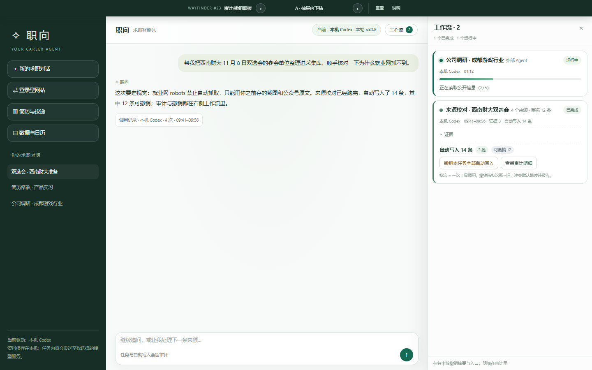 | 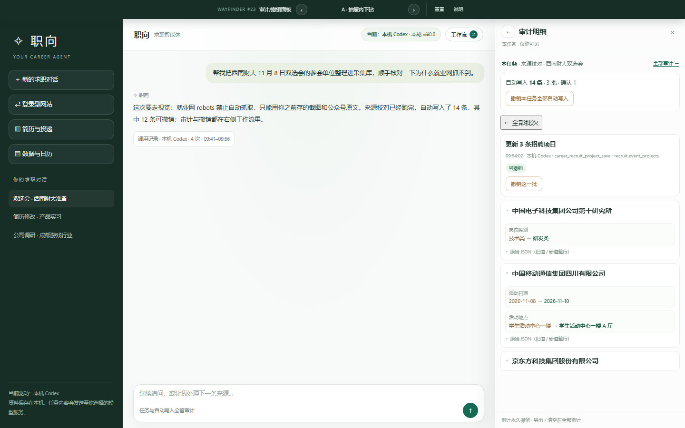 |

| A · 撤销后冲突（桌面） | A · 撤销后冲突（390×844） |
| --- | --- |
| 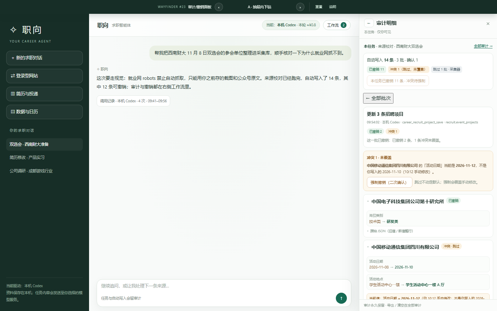 | 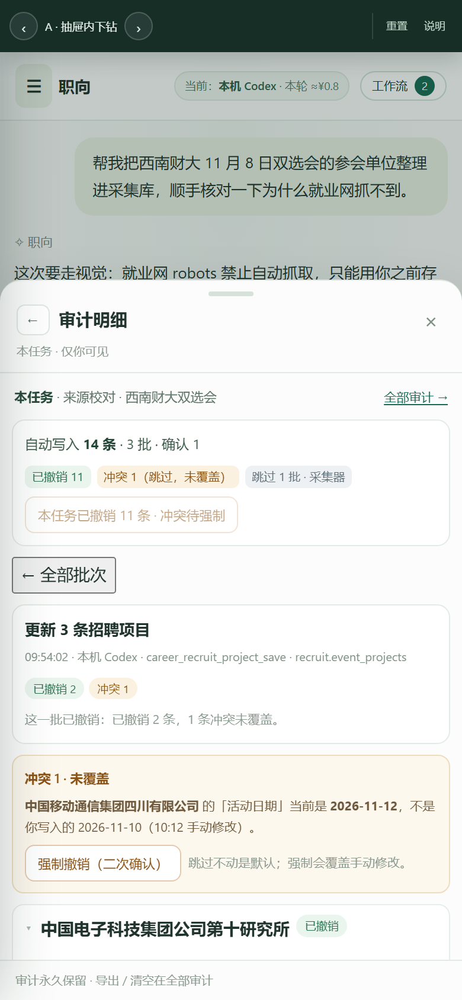 |

| B · 审阅层（桌面） | B · 撤销后冲突（桌面） |
| --- | --- |
| 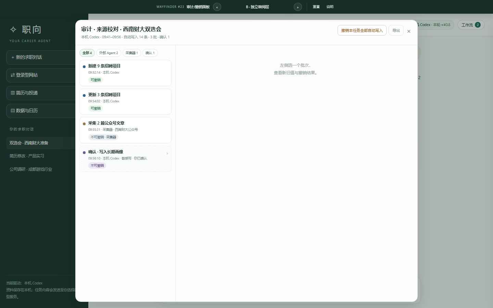 | 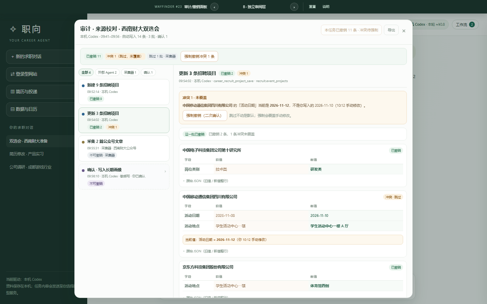 |

| B · 强制撤销二次确认（桌面） | B · 手机详情（390×844） |
| --- | --- |
| 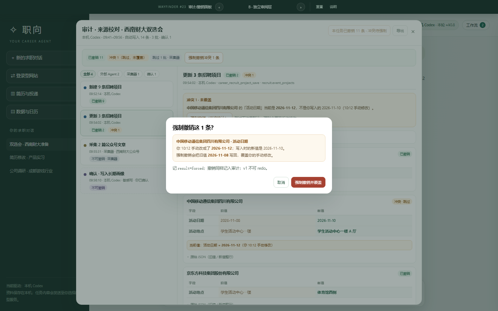 | 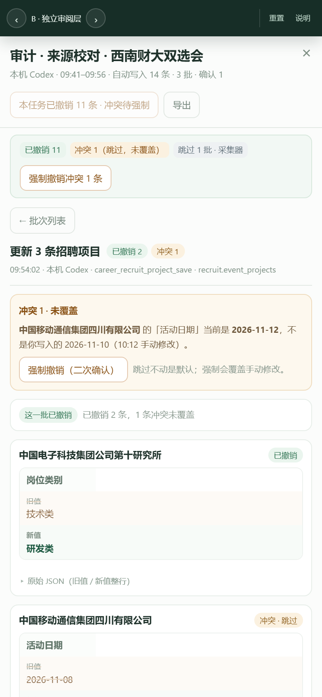 |

| C · 任务内审计（桌面） | C · 撤销后冲突（桌面） |
| --- | --- |
| 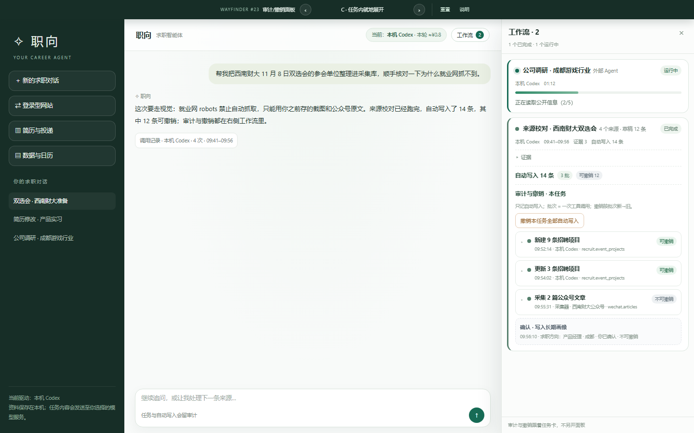 | 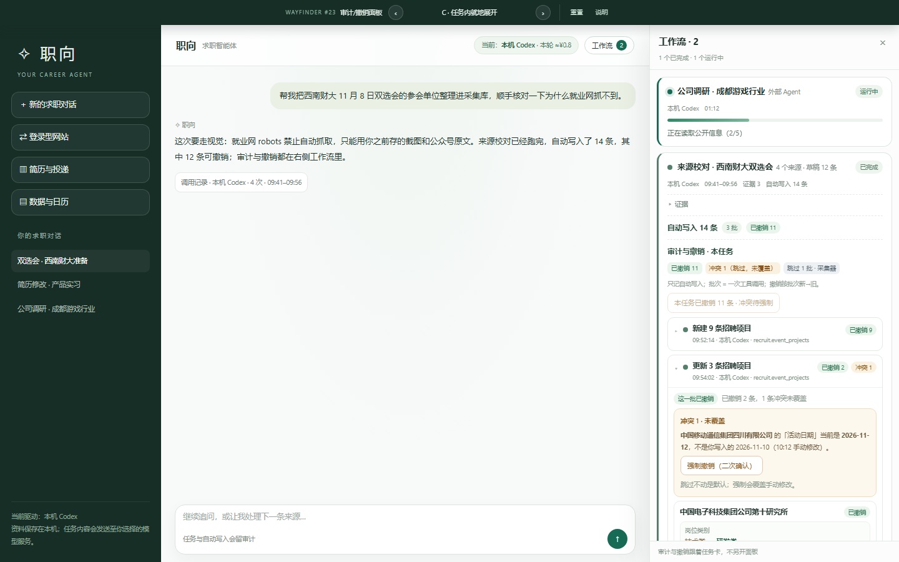 |

| C · 撤销后冲突（390×844） | B · 手机列表（390×844） |
| --- | --- |
| 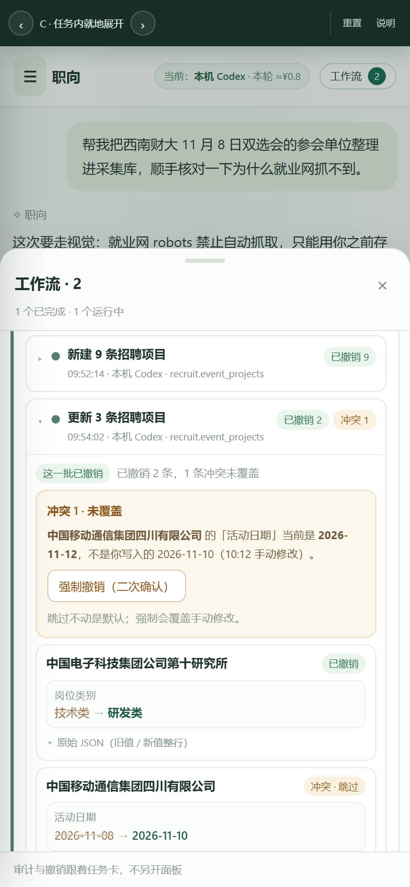 | 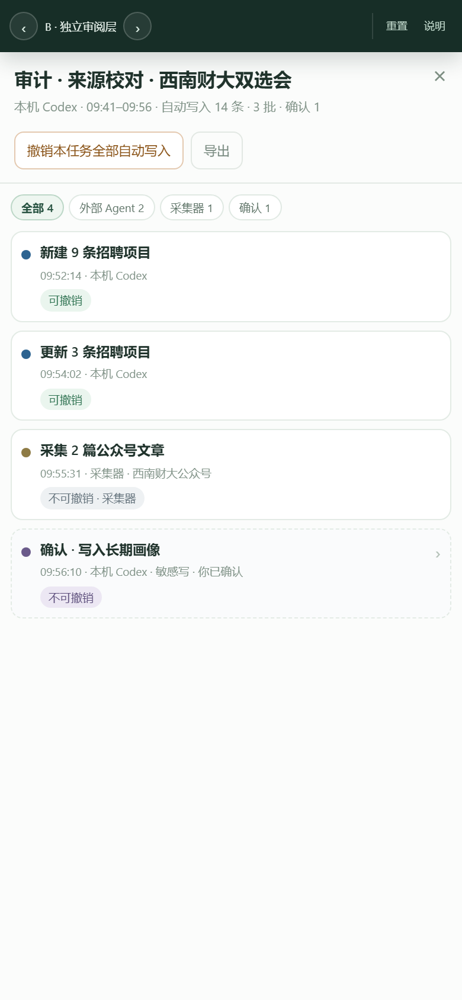 |

## 文件

- `index.html`：全部内容（CSS/JS 内联）；顶栏带变体切换与「说明」。
