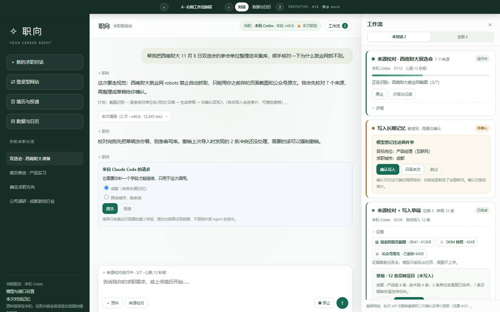
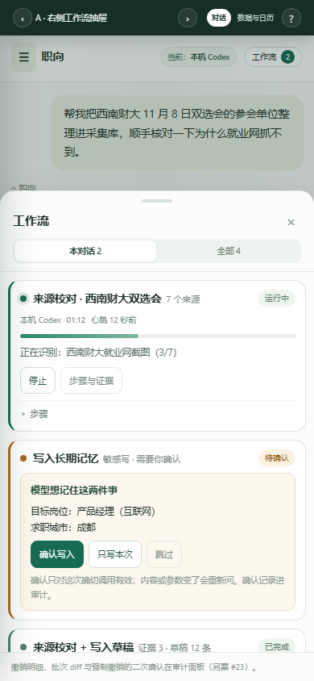
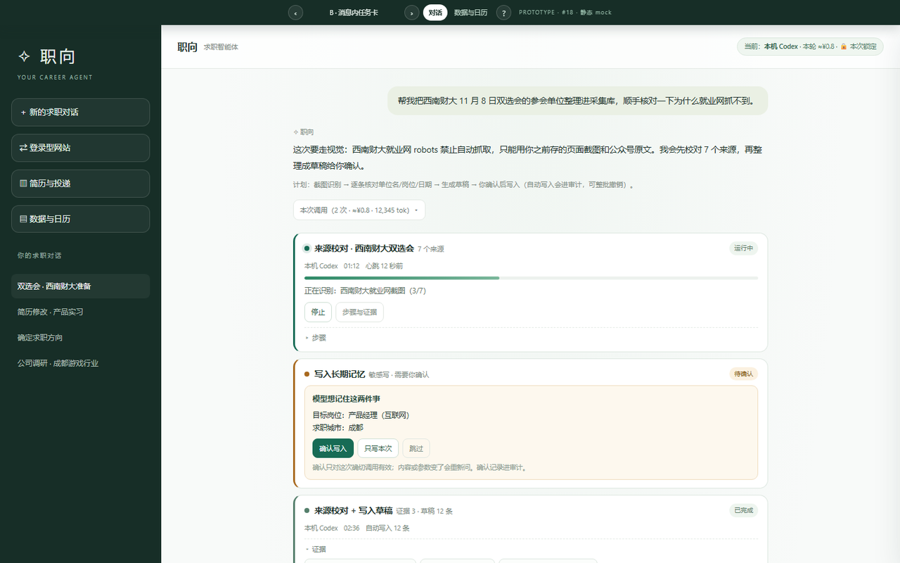
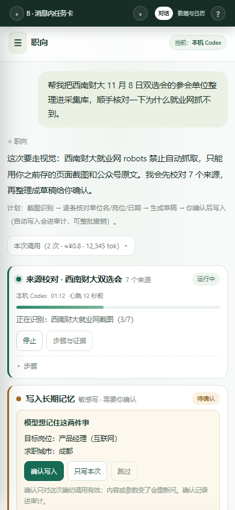
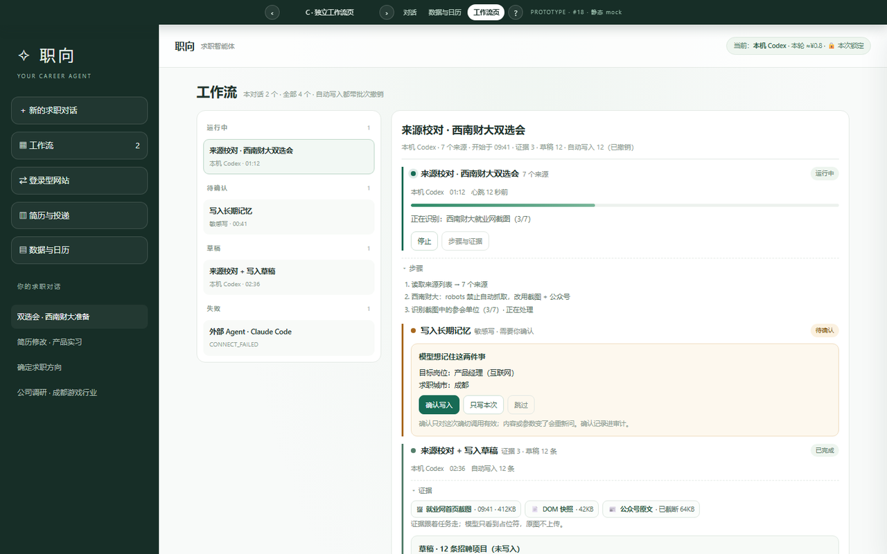
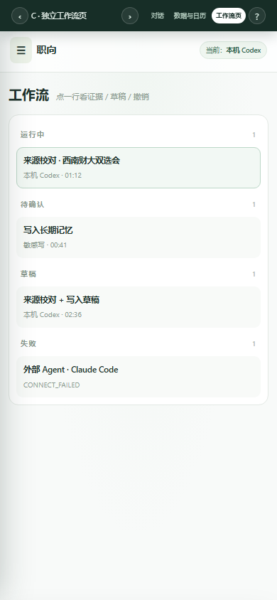

# 工作流面板与任务状态 · 原型（#18）

> Wayfinder 票 [#18](https://github.com/Lumichelka/career-agent/issues/18)，父地图 [#12](https://github.com/Lumichelka/career-agent/issues/12)。
> 状态：**原型，不是实现**。静态 mock，不接后端、不改正式代码。

## 决定（2026-10-26，真人选定）

- 入口：**A · 右侧抽屉**。不做新一级页面（C 关闭），侧栏不加「工作流」。
- 发起：数据与日历「来源校对」→ **回对话并打开面板**，任务卡置顶；数据页只发起，不再多弹一次。
- 手机：**底部抽屉（72vh）**，与桌面同一入口语义。
- 撤销 / 草稿：任务卡只放摘要 + 入口（已撤销 N / 冲突 M / 强制撤销 / 查看审计），批次列表与 diff 归 #23；草稿留在任务卡，不跟助手消息走。
- 边界不变：调用记录只在助手消息下（#17）；外部 Agent 配置归 #24。

## 在问什么

网页端的「工作流 / 外部 AI」入口和任务状态应该怎么呈现？对话页的工作流面板、数据与日历页的「来源校对」发起、任务运行/证据/草稿/撤销状态；以及**不做新一级页面还是新增面板**、手机端怎么退化。

## 怎么跑

双击 index.html 即可（无构建、无依赖）。或者在仓库根执行：

    python -m http.server 8765
    # 打开 http://127.0.0.1:8765/prototype/workflow-panel/?variant=A

- 底栏（桌面在顶部中间；手机在右上）切换 **A / B / C**，方向键也能切。
- 底栏「对话 / 数据与日历」切换两个页面；C 变体多一个「工作流页」。
- URL 参数可分享：?variant=A|B|C&surface=chat|recruit|workflow 。
- 手机宽度：DevTools 设 390×844，或 ?variant=A 后看底部抽屉 / B 的内联卡 / C 的列表与详情。

## 截图

| A · 右侧抽屉（桌面，抽屉常开） | A · 手机（底部抽屉） |
| --- | --- |
|  |  |

| B · 消息内任务卡（桌面） | B · 手机 |
| --- | --- |
|  |  |

| C · 独立工作流页（桌面） | C · 工作流队列（手机） |
| --- | --- |
|  |  |

「来源校对」的发起面（数据与日历页）：[桌面](screenshots/A-recruit-desktop.png) · [手机](screenshots/A-recruit-mobile.png)。

## 三个变体（结构不同，不是换皮）

| | 入口 | 任务状态落在哪 | 手机退化 |
| --- | --- | --- | --- |
| **A · 右侧抽屉** | 顶栏「工作流 · 2」 | 右侧 400px 抽屉，按任务卡堆叠 | 变底部抽屉（72vh，可滚） |
| **B · 消息内联** | 输入框上方快捷条 | 对话里的消息卡，随对话滚 | 全宽卡片，天然退化 |
| **C · 独立工作流页** | 侧栏一级「工作流」 | 队列 + 任务详情两栏页 | 队列全屏，详情二级覆盖 |

## 已遵守的上游决议

- 顶栏常驻：当前后端、本轮 ≈¥、本次锁定（[#17](https://github.com/Lumichelka/career-agent/issues/17)）。
- 调用记录只挂在**助手消息下**，**不进**工作流任务详情（#17）。
- 状态与字段：进度单调、心跳、90 秒「可能失联」、取消、统一信封、证据资产、错误码 + recovery（[#13](https://github.com/Lumichelka/career-agent/issues/13)）。
- 审计只记自动写入；批次 = 一次工具调用，任务可整撤；冲突跳过并报告、可强制；敏感四类走 confirm_id（[#15](https://github.com/Lumichelka/career-agent/issues/15)）。
- **审计列表 / 批次 diff / 强制撤销二次确认** 归 [#23](https://github.com/Lumichelka/career-agent/issues/23)；**外部 Agent 配置 / 连接状态** 归 [#24](https://github.com/Lumichelka/career-agent/issues/24)。这里只留入口与摘要。

## 需要你拍板的

1. **入口形态**：A 抽屉 / B 内联 / C 一级页面？还是 A 的入口 + B 的卡片？
2. **「来源校对」发起后**：回对话（A/B）还是去工作流页（C）？人要不要离开数据页？
3. **手机端**：A 的底部抽屉、B 的全宽卡、C 的列表→详情，哪种更顺手？
4. **撤销入口**：本任务卡里只放「已撤销 N / 冲突 M + 强制撤销」够不够，明细全交给 #23？
5. **草稿**：草稿该待在任务卡里，还是跟着助手消息走（像现有 artifact 卡）？

## 已知限制

- 无后端、无持久化；按钮只做就地演示（停止、确认、保存草稿、强制撤销、来源校对）。
- 「数据与日历」在原型里保留了对话外壳，只截取来源列表；真实页面是独立布局（src/web/recruit.html），本票不改它，只看「来源校对」的落点。
- 证据是占位；真实缩略图 / 原图存储归地图 fog（截图存储与脱敏另票）。
- 手机截图由 390×844 真实视口导出（CDP 设备模拟），页面 `scrollWidth = 390`，无横向溢出。
- 截图里的顶栏是**原型切换条**（A/B/C + 页面切换），不属于设计本身。
- 基线：origin/dev（远端 dev），分支 prototype/workflow-panel，**不合并、不提升**。

## 文件

- index.html：全部内容（CSS/JS 内联，无外部请求）。底部分支说明与原型切换逻辑都在里面。
